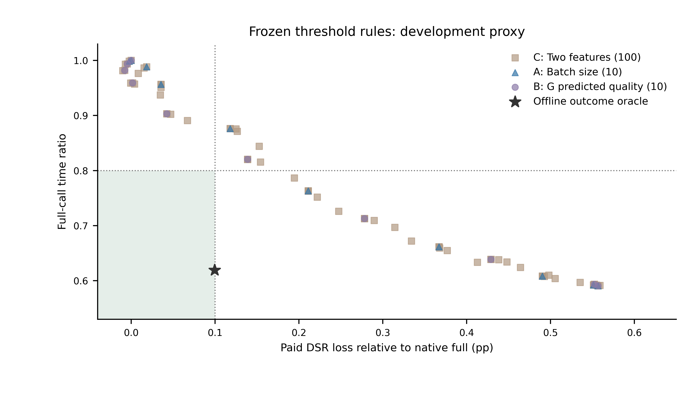

# 简单入口门控开发验证

2026-10-28。本轮已实现独立门控适配器，并完成工程边界验证；预定阈值筛选未产生可用规则，按事先写定的停止条件结束，没有启动75回合性能复验或独立确认。

**结论：离线oracle的选择空间仍成立，但本轮预定的单特征阈值和双特征合取阈值没有把这项空间转化为满足原质量—时间目标的开发规则。该结论限定于既定网格、规则形状、两分支和开发状态，不证明两个特征或所有入口门控都无效。**

## 1. 实现完成了什么

新适配器独立于封存PricedPolicy：先求一次共同G（贪心加最多128次普通修复），再提取接纳批量n与G公开预测按时比例q。q直接使用G已算出的公开预测时延，加原名义10ms；不读取真实缓存、执行结果或离线DSR。

门控位于二值初始化匹配、提议、解析评分和匹配之前。跳过时直接返回同一个G；进入时将G和修复诊断交回原生初始化入口，原候选构造、匹配、能耗筛选和价格选择逻辑不变。没有修改封存主方法、上层参数、价格、物理模型或论文。

固定规则为A的`n>=n0`、B的`q<q0`、C的`n>=n0且q<q0`。n阈值10个、q阈值10个，分别得到10、10和100个候选规则。结果揭示后没有追加OR规则、细化网格、分类器或其他候选机制。

## 2. 阈值筛选及停止决定

每次只用四个历史块选择阈值，留出第五块，轮换五次。此前特征方向已经看过全部五块，因此这是隔离阈值选择的开发留一验证，不是对完整特征研发过程的独立盲验证。

训练折预定平均DSR损失不超过0.05个百分点，且每训练块损失不超过0.10个百分点，以保留质量余量；同时要求完整时间比不超过0.80，两项机队能耗比不超过1.05，MBS/接纳增量不超过0.30个百分点。MBS界值是本轮新增研发选择，不追认为原C0门槛。

**十五个“留一折×规则族”全部未选出阈值，均按协议回退为原生Full。** 全五块汇总选择也全部回退。不是在留出块上得到了十五个独立阴性效果，而是训练折就没有产生满足条件的候选；这些重叠折的独立单位仍只有五个历史块。

为核对是否只是0.05个百分点的安全余量导致失败，另外在同一已冻结网格中描述原0.10个百分点标准，没有改变所选规则。十五个训练折仍然没有同时满足原平均质量、每块质量及20%时间目标的规则。

下表使用全部五块，仅解释失败位置，不作为留出结果或部署性能。费用仍是C0原分支的既有实测费用，没有加上新门控成本，也没有用它与新计时拼算加速比。

| 固定规则族 | 达到至少20%代理节时者中的最小DSR损失/百分点 | 满足原质量及资源约束者的最低时间比 |
|---|---:|---:|
| A，批量阈值 | 0.211054 | 0.988454 |
| B，G预测质量阈值 | 0.278171 | 0.959143 |
| C，双特征合取阈值 | 0.194615 | 0.951124 |

因此，当前网格中节时达到20%的规则，其质量损失已超过0.10个百分点。保住原质量及资源要求时，时间比又明显高于0.80。候选关联的方向一致，没有自动形成足够准确的低收益状态选择规则。

图中保留全部120个全五块开发候选，包括重复点。阴影为质量损失≤0.10个百分点且时间比≤0.80的区域；星号为先前同一固定标签上的结果oracle。星号进入区域而阈值点未进入，表现的是离线信息与这组公开规则之间的差距，不是新算法的真实加速。

## 3. 工程验证结果

五个服务器单线程进程共核对1200个原固定状态，检查全部通过：

- 强制进入分支与原生Full的候选、最终分配、预测量和匹配调用数一致。
- 强制跳过与原生G的返回值一致，且不会创建复杂搜索状态。
- 每次门控调用只执行一次共同G修复。
- 精简特征的q与上一轮六特征诊断中的q一致，没有换一个预测器。
- 五块分别对进入、跳过各作一次完整调用检验，共10项；共同注入12.3ms时，轨迹动作、分配、反馈、奖励和下一状态一致。门控代码本身位于完整计时范围内。
- 空批次合法返回，不调用复杂初始化或匹配。

另有两项真实数值集成测试，通过非强制规则分别跨越A/B/C的阈值两侧，以及检查非法调用在计算G前被拒绝。两项阈值开发测试确认留出块结果不能影响训练阈值、没有安全节时规则时确实回退Full。

12.3ms是工程等价测试的共同固定费用，不是新门控的性能测量。1200状态的验证也不是1200个独立效果样本。没有用这些工程调用声称在线节时或非劣效。

## 4. 没有进入哪些阶段

预先冻结的协议规定，若所有折均回退Full，不运行五种实际相同的Full闭环来制造无意义对照。本轮据此没有启动：

- 五方法的1200状态三重复新完整计时性能比较。
- 75个1000步闭环开发回合。
- 任何独立确认、非劣效主检验、新上层训练或学习选择器。
- 增量候选生成、监控式停止或论文结论改写。

因此，当前正确状态是“入口适配器可复核，既定简单阈值开发筛选失败”。不能写成实际门控已经达到某个加速比，也不能写成真实完整费用已经否定所有门控。若未来重新研究，应明确改变了什么问题或信息依据，保留本次失败，并另定协议；本轮不会自动增加复杂度。

## 5. 技术尝试及验收

第一次阈值结果写出遇到NumPy布尔量无法直接序列化的技术错误，未写出规则文件。修正为原生bool后，保留原失败目录和日志，在selection_02重新执行；网格、样本、筛选门槛及排序没有改变，不属于按效果重跑。

全部数值筛选、工程验证与科学绘图在已登记服务器完成。本机只编写代码、检查文件及对既有PDF作只读几何和目视核验。科学图源检查20项通过，另有PNG预览未提供投稿TIFF的一项预期提示；最小字形7pt，碰撞0错误、0警告。原C0及oracle输入保留。

## 6. 证据入口

- [冻结开发协议](../plans/chapter5_entry_gate_20261028.md)。
- [门控适配器](../../scripts/analysis/chapter5_entry_gate_policy.py)、[阈值开发](../../scripts/analysis/chapter5_entry_gate_select.py)、[工程验证](../../scripts/analysis/chapter5_entry_gate_verify.py)、[失败诊断](../../scripts/analysis/chapter5_entry_gate_diagnostics.py)。
- [五折规则与输入摘要](../../results/chapter5_entry_gate_20261028/selection_02/rules.json)、[全部阈值记录](../../results/chapter5_entry_gate_20261028/selection_02/threshold_grid.json)、[留出代理记录](../../results/chapter5_entry_gate_20261028/selection_02/heldout_proxy_metrics.csv)。
- [失败位置表](../../results/chapter5_entry_gate_20261028/screen_diagnosis_01/screen_diagnostics.csv)、[工程完成回执](../../results/chapter5_entry_gate_20261028/engineering_01/completion.json)、[逐块工程记录](../../results/chapter5_entry_gate_20261028/engineering_01/blocks/)。
- [图PDF](../../results/chapter5_entry_gate_20261028/screen_diagnosis_01/figures/entry_gate_grid.pdf)、[图源表](../../results/chapter5_entry_gate_20261028/screen_diagnosis_01/figures/entry_gate_grid_source.csv)、[验收日志](../../output/chapter5_entry_gate_20261028/validation/)。

当前第五章仍由原二十块正式确认支撑；本轮只新增独立研发记录，没有提交或推送Git。
