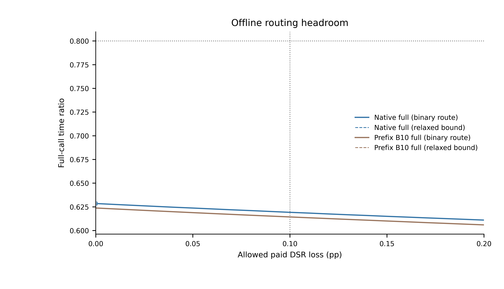
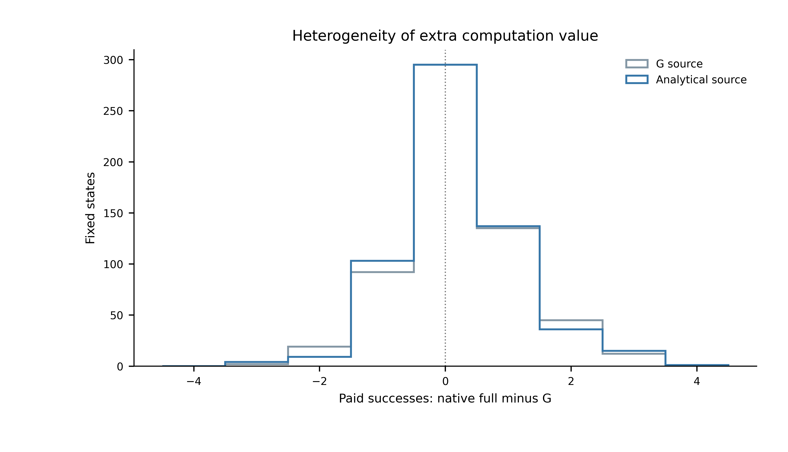
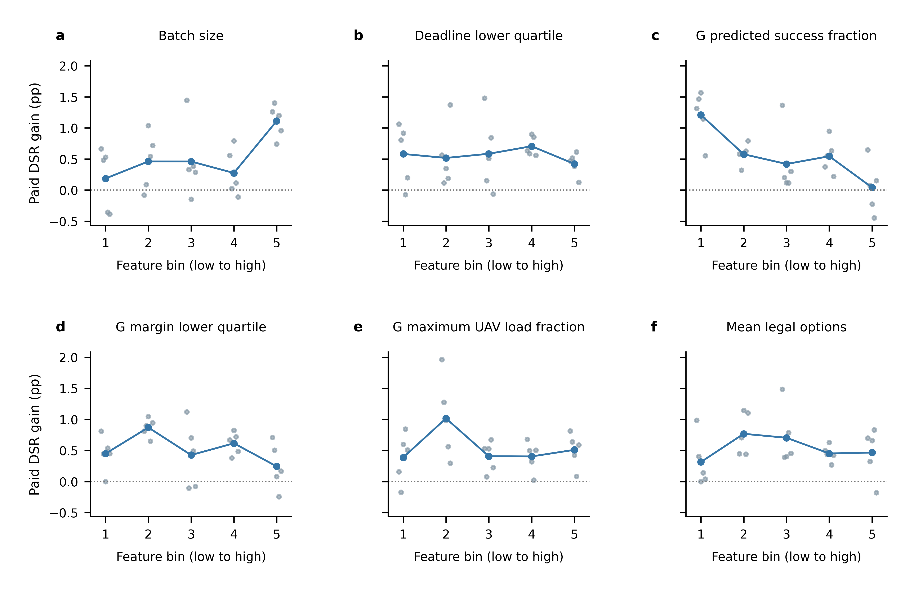

# 第五章额外计算价值与公开特征诊断

2026-10-28。已完成服务器端离线诊断，复用C0的1200个固定状态，没有重跑轨迹、训练选择器或修改第五章。

**结论：既有G与完整解析方法之间存在明显的离线选择空间，不能因C0固定前缀失败而停止所有入口门控研究。两项公开特征出现跨五个开发块同向的描述性关联，但尚未建立可部署门控或留出预测能力。**

## 1. 设计与证据边界

主参照预先选为C0原生完整方法`native_B10`，同实现`B10`单独作敏感性分析。五个历史开发块、三个已用负载、两种源轨迹，共1200个主状态；每状态设计权重25。G与解析源各600状态，不加入额外冷启动态。

每状态一个二值路由，在G与完整解析方法之间选择，三个完整计时重复共享该路由。各次真实软件费用分别进入逐请求截止期判断，再取三次成功数和耗时的均值，没有挑最快重复。私有物理结果只用于离线标签。

主质量口径沿用原C0：块内先汇总加权成功数与实际生成数，再平均五个块的DSR差。时间和能耗先求块内比值，再跨块平均。不是平均逐步成功率，也不把所有请求当独立样本。全体请求加权率另存作补充。

优化目标为最小完整时间比，约束为DSR损失不超过允许值、相对完整方法的平均块机队能耗比不超过1.05、相对G的同类比值不超过1.05。主要判断点保持0.10个百分点和0.80时间比。没有增加新的MBS晋级门槛。

两分支使用各自独立完整调用的已测费用，门控和特征费用取零。因此结果是有限既有标签上的乐观选择边界，不是闭环上界或机载部署上界，也没有证明先获得G后能够无重复地复用完整算法初始化。

## 2. 主要判断点

| 完整方法参照 | 二值路由时间比 | 计费DSR差/百分点 | 机队能耗/完整方法 | 机队能耗/G | 返回G的状态比例 |
|---|---:|---:|---:|---:|---:|
| 原生完整方法（主参照） | 0.619189 | −0.099647 | 1.019568 | 1.003576 | 92.333% |
| 同实现B10（敏感性） | 0.614316 | −0.099821 | 1.019162 | 1.003182 | 92.667% |

主参照上的可行离线路由使完整时间下降约38.08%，通过原20%时间门槛及两项能耗要求。MBS占接纳比例相对原生完整方法下降约1.35515个百分点，为描述性结果。

在同一主点，连续松弛时间比为0.619154，与二值路由结果非常接近。两者共同限定的是本批固定标签上的选择空间，而不是总体可达性能。混合源主分布之外，G源和解析源单独求解的二值时间比分别约0.620856和0.617685，均有选择空间。

质量损失网格为0.00至0.20个百分点、步长0.01，两种参照分别求解二值路由与连续松弛。原生完整方法的零损失二值点在20秒限时内未证最优，仍找到时间比0.628483的可行路由；该点只报告可行值，图中以空心方块标明。其余曲线点达到求解器最优状态，所有数值仍受求解器容差约束。主要0.10个百分点判断点未超时。

## 3. 逐状态收益分布

原生完整方法相对G的三次计费成功数均值增量：

| 增量符号 | 固定状态数 |
|---|---:|
| 大于零 | 412 |
| 等于零 | 515 |
| 小于零 | 273 |

两方法分配完全相同的状态为144个。该数少于计费增量为零的状态数，说明分配是否改变不能代替额外服务收益标签。计费负增量同时包含物理分配差异与软件等待的影响，不能全部解释为计算等待造成。

oracle的92.333%返回G比例不等于“有92.333%的状态完整方法无收益”。优化允许在质量预算内跨状态取舍，G有利状态的收益也可能抵消其他状态的损失。任何实现规则都不能直接读取oracle路由或物理标签。

## 4. 额外费用敏感性

将假定的固定门控费用逐次加入两分支的原软件费用，重新核对每个请求的截止期后再优化，没有只在最终平均时间上加数。

| 假定每次额外费用 | 原生完整参照的二值路由时间比 | 原质量与能耗约束 |
|---|---:|---|
| 0.1 ms | 0.623490 | 通过 |
| 0.5 ms | 0.639231 | 通过 |
| 1.0 ms | 0.658876 | 通过 |

这些是假定费用下的离线敏感性，不是实测门控开销，也不是在线控制确认。

## 5. 六项公开特征的描述性分组

在观察特征与收益关系前，另行冻结六项清单。特征函数仅接收原公开请求行与G分配，不接收真实缓存、物理成功、完整方法候选或oracle路由。G的预测按时比例与余量采用公开平均时延模型加原名义10ms，不能称真实成功概率。

各特征按全开发状态的分位点分组，等值特征不拆分。灰点显示五个块的组内计费DSR增量，蓝线为可用块的均值。分组使用实际生成数作为分母，所有状态保留，没有训练内最佳阈值扫描。

| 特征 | 最高组减最低组的额外DSR收益方向 | 本轮解释 |
|---|---|---|
| 接纳批量规模 | 五块均为正 | 大批量具有更高额外收益的候选关联 |
| G公开预测按时比例 | 五块均为负 | G预测质量较高时，完整方法额外收益较低的候选关联 |
| 截止期下四分位数 | 四负、一正 | 方向有例外 |
| G归一化余量下四分位数 | 三负、两正 | 方向不稳定 |
| G最大UAV负载比例 | 三正、两负 | 方向不稳定 |
| 平均合法选项数 | 两正、三负 | 方向不稳定 |

批量规模的最高减最低组差为各块约+0.214至+1.554个百分点；G预测按时比例的相应差为约−1.791至−0.400个百分点。这是开发样本内按既定分组得到的描述，不是显著性、因果关系、分类准确率或独立泛化证据。分位点不作为部署阈值，不能推断中间各组逐级单调。

六项特征联合提取函数的首次平均耗时约0.217 ms，后续10次重复的平均耗时约0.182 ms。请求构造与求解G已在计时前完成，这不是完整门控费用；该单核诊断计时也不与C0服务器背景条件直接计算部署加速比。

## 6. 下一阶段判断

第一步支持继续检查入口门控，第二步给出两个值得后续验证的公开信号。现阶段没有实现在线门控，也没有理由恢复大规模PPO或同时加入惰性提议与动态停止。

下一项应是独立的简单门控验证协议，优先考虑批量规模与G公开预测质量，并保留特征计算、G复用、剩余公共路径和完整返回费用。先在开发资料内固定规则，再用未用于选规则的资料检验；不能把本轮1200状态重新命名为确认集。原二十块主确认也不自动成为新门控确认集。

当前图只显示关联，尚不能证明某一公开阈值在原0.10个百分点/20%门槛下可行。独立闭环确认、惰性提议、监控式停止和新基座训练均未启动，原第五章主结论保持原证据层级。

## 7. 验证与复现入口

- [诊断协议](../plans/chapter5_oracle_gate_20261028.md)、[特征协议](../plans/chapter5_gate_features_20261028.md)。
- [oracle汇总](../../results/chapter5_oracle_gate_20261028/attempt_01/summary.json)、[输入审计](../../results/chapter5_oracle_gate_20261028/attempt_01/input_audit.json)、[执行协议](../../results/chapter5_oracle_gate_20261028/attempt_01/execution_protocol.json)、[完成回执](../../results/chapter5_oracle_gate_20261028/attempt_01/completion.json)。
- [逐状态增量](../../results/chapter5_oracle_gate_20261028/attempt_01/state_deltas.csv)、[曲线源表](../../results/chapter5_oracle_gate_20261028/attempt_01/curve.csv)、[离线路由](../../results/chapter5_oracle_gate_20261028/attempt_01/routes.json)。
- [特征汇总](../../results/chapter5_oracle_gate_20261028/features_01/summary.json)、[公开输入审计](../../results/chapter5_oracle_gate_20261028/features_01/input_audit.json)、[分组源表](../../results/chapter5_oracle_gate_20261028/features_01/feature_bins.csv)。带离线结果列的特征CSV只用于分析，不作为线上输入合同。
- [oracle源码](../../scripts/analysis/chapter5_oracle_gate.py)、[公开特征源码](../../scripts/analysis/chapter5_gate_features.py)、[绘图源码](../../scripts/analysis/chapter5_oracle_gate_figure.py)、[枚举验证](../../tests/test_chapter5_oracle_gate.py)。

服务器完成原C0三方法固定状态DSR和完整均值的五块重构核对，逐请求费用标签核对，原始输入摘要核对，以及三项优化器/聚合/截止期针对性验证。未在本机重算科研效应或绘图。

三图均在服务器以Python导出PDF/SVG及600dpi PNG。六面板最终几何对齐通过，三图PDF最小字形均为7pt；本机仅对既有PDF进行只读几何核验，三图碰撞均为0错误、0警告。各面板和整图均完成目视检查。

绘图源检查20项通过，另有1项预期提示，即本次提供PNG诊断预览，没有生成投稿TIFF；不将其表述为21项全通过。服务器原环境缺少PDF审计依赖，隔离安装因缺少编译器失败，最终使用本机现有PyMuPDF完成只读审计，没有改动服务器共享Conda环境。安装失败日志保留，不影响统计或服务器绘图结果。

[验证记录目录](../../output/chapter5_oracle_gate_20261028/validation/)保留输入检查、三项测试、求解日志、源检查、字体检查、碰撞JSON和QA叠加PDF。叠加PDF只用于验收，原图仍以results目录中的PDF为准。
