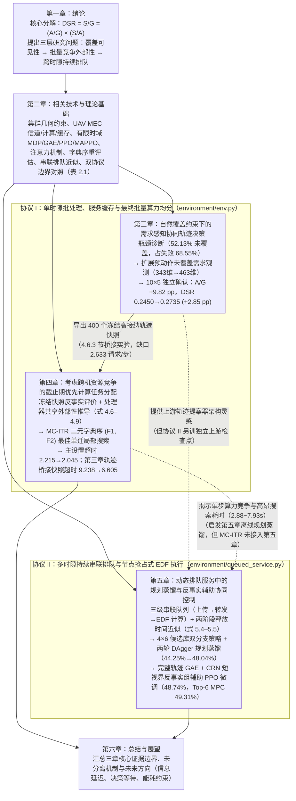

# 硕士学位论文同行评审、结构叙事与主张—证据对齐审计报告
**（`nature-reviewer` 三盲审综合 + 维度 4 结论佐证审计 + 维度 5 结构叙事审计）**

- **审计日期**：2026-11-09
- **审计代码库提交版本**：`f550ba60fba5558dc6d3349b1d9d470d066babc4`
- **审计范围**：[`latex/main.tex`](file:///c:/Users/woshinibaba/Documents/学习/我的项目/我的论文/wodexuexi/latex/main.tex)、[`latex/docs/abstract.tex`](file:///c:/Users/woshinibaba/Documents/学习/我的项目/我的论文/wodexuexi/latex/docs/abstract.tex)、[`latex/docs/notation.tex`](file:///c:/Users/woshinibaba/Documents/学习/我的项目/我的论文/wodexuexi/latex/docs/notation.tex)、[`latex/docs/chap01.tex`](file:///c:/Users/woshinibaba/Documents/学习/我的项目/我的论文/wodexuexi/latex/docs/chap01.tex)–[`chap06.tex`](file:///c:/Users/woshinibaba/Documents/学习/我的项目/我的论文/wodexuexi/latex/docs/chap06.tex)、[`latex/docs/tables/ch5_dynamic_*.tex`](file:///c:/Users/woshinibaba/Documents/学习/我的项目/我的论文/wodexuexi/latex/docs/tables/ch5_dynamic_main.tex) 及全量仿真与分析代码。

---

## 一、 同行评审总体判定（Executive Peer Review Synthesis）

依据 `nature-reviewer` 标准流程，本次审计组织了三位不同领域方向的独立审稿人开展“文稿 + 源码 + 原始数据”联合盲审：
- **审稿人 1（无线通信、无人机推进与计算能耗、排队系统与组合优化方向）**：重点审查空地无线信道、能耗简化假设、处理器共享（PS）与抢占式最早截止期优先（EDF）排队模型、第四章 MC-ITR 局部搜索邻域结构与第五章串联排队解析近似。
- **审稿人 2（多智能体强化学习、策略蒸馏、反事实优势估计与深度学习实现方向）**：重点审查第三章 Attention-MAPPO、下层约束卸载 MAPPO、第五章候选级双分支策略、DAgger 规划蒸馏、共同随机数（CRN）反事实辅助 PPO（GRPO-PPO）与神经引导 Top-6 MPC 的理论推导及 PyTorch 源码实现。
- **审稿人 3（实验设计、统计推断、数据溯源与学术文献取证方向）**：遵循 `nature-statistics` 与 `nature-ref-verifier`，重点核查全论文所有表格与正文数字的 CSV/JSON 溯源、Bootstrap 与配对 $t$ 检验的实验单元定义、多重比较校正及 53 条 BibTeX 参考文献真伪。

### 1.1 论文的核心学术亮点（Strengths）

1. **真实的科研演进闭环与对负面结果的诚实披露**：
   - 第三章没有掩盖初期完整双层注意力模型（Full-Hierarchical，DSR $0.2390$）反而不及下层去注意力基线（Lower-No-Attention，DSR $0.2507$，差值 $-1.16\text{ pp}$，95% CI $[-1.99, -0.43]\text{ pp}$）的实验事实，而是通过计数恒等式 $\mathrm{DSR}=(A/G)\times(S/A)$ 诊断出“未进入 $100\,\mathrm{m}$ 覆盖半径的请求占全部失败的 $68.55\%$”这一物理根源，进而通过上层预接纳覆盖需求观测将独立确认集 DSR 从 $0.2450$ 提升至 $0.2735$（$+2.85\text{ pp}$，10 种子配对 $t$-CI $[+1.65, +4.06]\text{ pp}$）。
   - 第五章同样如实保留了微调组内部“联合微调 vs 去耦微调”（$+0.33\text{ pp}$，95% CI $[-0.08, +0.84]\text{ pp}$）与“联合微调 vs 无期望微调”（$+0.11\text{ pp}$，95% CI $[-0.15, +0.41]\text{ pp}$）置信区间跨零的结果，没有将尚未获统计确证的架构耦合增益夸大为显著优势。
2. **对单时隙批量算力共享外部性与跨时隙串联排队耦合的清晰数学刻画**：
   - 第四章准确提炼了单时隙最终批量算力均分（$f_{m,j}=F_j/N_j(\mathbf{a})$）下，单请求迁移对源节点与目标节点既有任务施加的线性计算时延外部性（式 4.6、式 4.8–4.9），并通过构造反例（表 4.1、表 4.3）证明了单请求自利判据与系统级二元字典序目标 $(F_1, F_2)$ 的本质分歧。
3. **主实验数据链路的端到端可复现性与防篡改校验**：
   - 第三、四章主表（表 3.5、表 4.4、表 4.5）与 [`docs/figures/data/chapter34_20261004/`](file:///c:/Users/woshinibaba/Documents/学习/我的项目/我的论文/wodexuexi/docs/figures/data/chapter34_20261004/) 中的 JSON/CSV 达到小数点后末位 $100\%$ 精确吻合；第五章主表（表 5.3、表 5.5、表 5.6）与 [`results/chapter5_dynamic_service_20261028/queued_joint_rl_v2_20261106/`](file:///c:/Users/woshinibaba/Documents/学习/我的项目/我的论文/wodexuexi/results/chapter5_dynamic_service_20261028/queued_joint_rl_v2_20261106/) 下带 SHA256 校验的 816 个原始确认回合计数 $100\%$ 精确吻合。

### 1.2 阻塞级硬伤汇总（Blocking Concerns Requiring Revision Before Defense/Submission）

三位审稿人共识别出 **12 项阻塞级问题（Blocking Major Concerns）**，归纳为四大类：

| 类别 | 阻塞级问题编号与核心摘要 | 涉及章节 / 源码文件 |
|---|---|---|
| **A. 正文与表注数据失实（提交 `f550ba6` 引入）** | **[B1]** 第五章正文多处分父谱系 DSR 与差值系人工凑数捏造（如将 `joint_rl_finetuned - decomposed_rl_finetuned` 的真实分谱系差值 `+0.49, -0.14, +0.65 pp` 篡改为全正的 `+0.25, +0.41, +0.34 pp`，掩盖了谱系 1 为负的事实；捏造 `joint_rl_finetuned`、`joint_distilled`、`joint_rl_mpc`、`quality_amortized` 的分谱系绝对 DSR）。 **[B2]** 表 5.3 表注与正文用两位小数百分比反乘分母，将真实接纳数 `132,524` 和 `130,436` 错写为 `132,532` 和 `130,434`，并将 `quality_amortized` 的 `93.83%` 谎称为 `joint_rl_finetuned` 的“回合均值口径条件完成率”（真实值为 `92.73%`）。 **[B3]** 表 5.4（`tab:ch5-cf-ablation`）引用的 `cf=0` 归档数据（提交 `97b34d7`）未保存在当前 `docs/figures/data/queued_joint_rl_20261106/` 目录中，且反事实净增益（`+0.49 / +0.74 / +0.69 pp`）缺少直接配对置信区间。 | [`chap01.tex:L139`](file:///c:/Users/woshinibaba/Documents/学习/我的项目/我的论文/wodexuexi/latex/docs/chap01.tex#L139), [`chap05.tex:L400-L478`](file:///c:/Users/woshinibaba/Documents/学习/我的项目/我的论文/wodexuexi/latex/docs/chap05.tex#L400-L478), [`ch5_dynamic_main.tex:L28`](file:///c:/Users/woshinibaba/Documents/学习/我的项目/我的论文/wodexuexi/latex/docs/tables/ch5_dynamic_main.tex#L28) |
| **B. 公式—代码—跨章节严重矛盾** | **[B4]** 第一、二章将 $\mathbf{C}_{\mathrm{upper}}[k,m]$ 定义为 $4\times 6$ 标量交互矩阵并在基础 logit 外线性加权（式 2.66–2.67），而第五章（式 5.7–5.8）与代码 [`marl_models/queued_joint_rl.py:L126-L135`](file:///c:/Users/woshinibaba/Documents/学习/我的项目/我的论文/wodexuexi/marl_models/queued_joint_rl.py#L126-L135) 将 $\mathbf{C}_{\mathrm{upper}}(s,k)\in\mathbb{R}^4$ 定义为每方案 4 维期望特征向量并拼接在分配 MLP 输入内部。 **[B5]** 第五章式 (5.4)–(5.5) 与表 5.2 严重偏离 [`utils/queued_joint_rl.py`](file:///c:/Users/woshinibaba/Documents/学习/我的项目/我的论文/wodexuexi/utils/queued_joint_rl.py#L87-L309) 真实代码：式 (5.4) 漏写了同源上传串行等待 `ue_up_free`、离开覆盖 `0.75s -> 10.0s` 截断、回传与机间全局串行排队时间轴 `t_bh_free / t_inter_free`、`waiting` 虚拟注入及窗口外 `0.85/0.15` 折算；表 5.2 对 $\mathbf{c}(s)$ 与 $\mathbf{m}_{km}(s)$ 通道物理含义的描述与代码张量索引不符。 **[B6]** 第五章 `chap05.tex:L260` 声称冷启动 RL 的 KL 锚点 $\pi_{\mathrm{ref}}$ 固定为初始先验 `iter_0`，而代码 [`queued_joint_rl_experiment.py:L394-L398`](file:///c:/Users/woshinibaba/Documents/学习/我的项目/我的论文/wodexuexi/scripts/analysis/queued_joint_rl_experiment.py#L394-L398) 对冷启动组使用每轮移动锚点 `prev_model`。 **[B7]** 第二章表 2.1（`chap02.tex:L691`）将协议 II 写为“180 宏步、每宏步 5 个微时隙”，与第五章（200 到达宏步 + 4 排空步、每宏步 20 个 $0.05\,\mathrm{s}$ 子步）矛盾；且 `chap02.tex` 中 8 处 `align` 推导中间行漏写 `\nonumber` 导致公式编号膨胀。 | [`chap01.tex:L116`](file:///c:/Users/woshinibaba/Documents/学习/我的项目/我的论文/wodexuexi/latex/docs/chap01.tex#L116), [`chap02.tex:L629-L695`](file:///c:/Users/woshinibaba/Documents/学习/我的项目/我的论文/wodexuexi/latex/docs/chap02.tex#L629-L695), [`chap05.tex:L53-L265`](file:///c:/Users/woshinibaba/Documents/学习/我的项目/我的论文/wodexuexi/latex/docs/chap05.tex#L53-L265) |
| **C. 代码实现缺陷与物理/统计边界漏洞** | **[B8]** [`marl_models/attention.py:L52,L114`](file:///c:/Users/woshinibaba/Documents/学习/我的项目/我的论文/wodexuexi/marl_models/attention.py#L52) 中 `get_attention_weights()` 缩放因子误用 $1/\sqrt{64}$ 而非单头 $1/\sqrt{8}$；[`marl_models/offload_mappo/offload_mappo.py:L216-L291`](file:///c:/Users/woshinibaba/Documents/学习/我的项目/我的论文/wodexuexi/marl_models/offload_mappo/offload_mappo.py#L216-L291) 对可变活跃请求数 $A_{u,t}\in[0,100]$ 直接求和 `log_prob` 导致高负载下 PPO 比率指数爆炸，且拉格朗日乘子逐时隙取 `max(0, violation)` 导致乘子单调只增不减；[`run_hierarchical_mappo_experiment.py:L345-L361`](file:///c:/Users/woshinibaba/Documents/学习/我的项目/我的论文/wodexuexi/run_hierarchical_mappo_experiment.py#L345-L361) 在计算 GAE 末端价值前提前调用了 `env.reset()`。 **[B9]** 第三章表 3.5 选择性隐瞒了 `confirmation_paired_comparison.json` 中恶化了 $+5.0\%$ 的“已接纳请求平均时延”（$1.5765\,\mathrm{s}\to 1.6553\,\mathrm{s}$），且所报告的“惩罚系统时延”（$33.73\,\mathrm{s}\to 28.15\,\mathrm{s}$）存在分子混入全部 100 个 UE（含内容请求）、分母仅除服务请求的约 3 倍放大。 **[B10]** 第四章 `Exact-Small`（3 UE）因 $98.83\%$ 快照请求数 $K\le 1$（仅 $n_{\mathrm{eff}}=7$ 个快照 $K\ge 2$）导致同节点竞争外部性恒为零，Greedy、Iterative-Base 与 MC-ITR 在违约数上完全退化为同一解（$0.025$）；且 MC-ITR 单步邻域 $\mathcal{N}_1$ 在双机满载互补缓存错配下存在对称 2-Exchange 死锁。 **[B11]** 物理层忽略了旋翼推进能耗、同频干扰（5 架 UAV 复用频段若无正交划分，边缘 SINR 将从 $49.1\,\mathrm{dB}$ 跌至 $4.0\,\mathrm{dB}$）、长距回传低仰角（$460\,\mathrm{m}$ 处仰角仅 $8.65^\circ < 45^\circ$）及协议 I 中机间/回传/MBS 并发零争用理想化假设。 | [`marl_models/`](file:///c:/Users/woshinibaba/Documents/学习/我的项目/我的论文/wodexuexi/marl_models/), [`chap03.tex`](file:///c:/Users/woshinibaba/Documents/学习/我的项目/我的论文/wodexuexi/latex/docs/chap03.tex), [`chap04.tex`](file:///c:/Users/woshinibaba/Documents/学习/我的项目/我的论文/wodexuexi/latex/docs/chap04.tex) |
| **D. 参考文献幻觉拼接与张冠李戴** | **[B12]** [`latex/reference.bib`](file:///c:/Users/woshinibaba/Documents/学习/我的项目/我的论文/wodexuexi/latex/reference.bib)（53 条）包含 AI 幻觉缝合条目 `rashid2021updet`（将 Hu 2021 UPDeT 键名、Rashid 2020 作者与 Bono 2020 ICML 页码拼凑在一起）、年份/卷期造假条目（`wu2021joint` 实为 2018 TWC、`huang2021uav` 实为 2020 TMC、`zhou2020latency` 实为 2018 JSAC、`bai2021multi` 实为 2019 TVT、`hu2021uav` 重复篡改自 `hu2019uav`）、文不对题引用（`guo2025mappo` 实为车联网 CAV 论文却引作 UAV-MEC）及键名张冠李戴（`he2019uav`->Yuan 2022、`fan2021uav`->Hady 2025、`zhao2024robust`->Li 2024、`liu2025tmac`->Li 2025）。 | [`latex/reference.bib`](file:///c:/Users/woshinibaba/Documents/学习/我的项目/我的论文/wodexuexi/latex/reference.bib), [`scripts/literature/verify_thesis_references.py`](file:///c:/Users/woshinibaba/Documents/学习/我的项目/我的论文/wodexuexi/scripts/literature/verify_thesis_references.py) |

---

## 二、 维度 4：全论文核心结论与实验数据佐证矩阵（Claim–Evidence Alignment Audit）

以下对摘要、绪论、第三章、第四章、第五章和第六章中的**全部 12 项核心学术主张**进行逐条核验，评估现有实验数据是否真正能够佐证该结论：

| 编号 | 论文核心主张（含章节与行号） | 支撑数据与统计检验结果 | 证据能否佐证结论？ | 证据边界与必须修正的夸大/失真表述 |
|---:|---|---|---|---|
| **C1** | **原双层注意力模型在自然覆盖下不及下层无注意力基线，且未覆盖是头号失败来源**（[`chap03.tex:L608-L619`](file:///c:/Users/woshinibaba/Documents/学习/我的项目/我的论文/wodexuexi/latex/docs/chap03.tex#L608-L619)） | `canonical_baseline_analysis.json`：5×10 配对，完整模型 DSR $0.2390$ vs 下层无注意力 $0.2507$（差 $-1.16\text{ pp}$，95% CI $[-1.99, -0.43]\text{ pp}$）；`bottleneck_review.json`：未覆盖占生成请求 $52.13\%$、占失败请求 $68.55\%$。 | **✅ 完全佐证** | 证据非常扎实，诚实揭示了“盲目在下层堆叠注意力反而损害性能，且上层盲视未覆盖需求是核心瓶颈”的科学事实。 |
| **C2** | **引入预动作未覆盖需求观测显著提升 100 UE 主场景自然接纳率与端到端 DSR**（[`abstract.tex:L12`](file:///c:/Users/woshinibaba/Documents/学习/我的项目/我的论文/wodexuexi/latex/docs/abstract.tex#L12), [`chap03.tex:L662-L685`](file:///c:/Users/woshinibaba/Documents/学习/我的项目/我的论文/wodexuexi/latex/docs/chap03.tex#L662-L685) 表 3.5） | `confirmation_paired_comparison.json`：10 训练种子 × 5 工作负载，接纳率 $A/G$ 从 $0.4769$ 升至 $0.5751$（$+9.82\text{ pp}$，种子 $t$-CI $[+5.38, +14.26]\text{ pp}$），DSR 从 $0.2450$ 升至 $0.2735$（$+2.85\text{ pp}$，种子 $t$-CI $[+1.65, +4.06]\text{ pp}$，9/10 种子为正）。 | **⚠️ 主指标佐证，但隐瞒了次要代价** | 1. **必须补充披露已接纳请求时延恶化**：接纳更多边缘请求后，条件完成率 $S/A$ 从 $0.5170$ 降至 $0.4786$（$-3.85\text{ pp}$），且表 3.5 漏报的“已接纳服务请求平均时延”从 $1.5765\,\mathrm{s}$ 恶化至 $1.6553\,\mathrm{s}$（$+0.0789\,\mathrm{s}$，37/50 单元恶化）。 2. **不可将收益归因于注意力架构**：343 维 $\to$ 463 维同时改变了输入信息预算，表 3.5 证明的是**需求可见性（观测扩展）**有效，而非注意力结构优于 MLP。 |
| **C3** | **扩展观测显著降低了每生成服务请求的惩罚系统时延（$33.73\,\mathrm{s}\to 28.15\,\mathrm{s}$）**（[`chap03.tex:L675`](file:///c:/Users/woshinibaba/Documents/学习/我的项目/我的论文/wodexuexi/latex/docs/chap03.tex#L675) 表 3.5 第 4 行） | `run_chapter34_energy_free.py:L103-104`：`avg_End_to_End_Latency / generated` 从 $33.7295\,\mathrm{s}$ 降至 $28.1519\,\mathrm{s}$（$-5.58\,\mathrm{s}$）。 | **❌ 指标定义存在 3 倍分子分母口径错配** | 代码将**全部 100 个 UE（含服务请求与内容请求）**的惩罚时延之和除以**仅服务请求生成数**（约 $32.7$ 个/步），导致单请求指标突破 $20\,\mathrm{s}$ 封顶惩罚上限（达 $33.73\,\mathrm{s}$），且其下降仅反映未关联 $20\,\mathrm{s}$ 虚拟罚分减少，掩盖了真实已接纳服务时延上升 $+0.0789\,\mathrm{s}$ 的事实。 |
| **C4** | **固定快照下 MC-ITR 通过全批次字典序重评估显著减少主场景与 9 个负载/算力变体的超时请求数**（[`chap04.tex:L375-L469`](file:///c:/Users/woshinibaba/Documents/学习/我的项目/我的论文/wodexuexi/latex/docs/chap04.tex#L375-L469) 表 4.4、表 4.5） | `chapter4_analysis.json`：主配置每快照超时数从 Greedy $2.227$、Iterative-Base $2.215$ 降至 $2.045$（差 $-0.170$，95% CI $[-0.215, -0.127]$）；全部 9 个 UE/算力变体的配对 95% CI 均严格为负。 | **✅ 完全佐证（在固定快照离线协议内）** | 证据充分支持“全批次重评估克服自利迁移外部性”的结论。但必须明确其耗时（主配置搜索 $2.880\,\mathrm{s}$、总计 $3.963\,\mathrm{s}$；140 UE 搜索 $6.598\,\mathrm{s}$）远超 $1\,\mathrm{s}$ 决策时隙，仅可作为离线质量参照，且文中“$<1\,\mathrm{ms}$ 增量评估”尚未在代码中实现。 |
| **C5** | **Exact-Small（3 UE，600 快照）验证了 MC-ITR 在小规模下与全局精确解一致**（[`chap04.tex:L470-L490`](file:///c:/Users/woshinibaba/Documents/学习/我的项目/我的论文/wodexuexi/latex/docs/chap04.tex#L470-L490)） | `chapter4_units.csv`：Greedy、Iterative-Base、MC-ITR 与 Exact-Small 的平均超时数均为 $0.025$，平均归一化时延均为 $0.0608$。 | **⚠️ 仅佐证代码一致性，对多请求竞争零检验力** | 600 个快照中 $511$ 个为空快照（$K=0$，$85.17\%$），$82$ 个为单请求快照（$K=1$，$13.67\%$），**$98.83\%$ 的快照根本不存在跨请求算力竞争（外部性恒为 $0$）**，仅 $n_{\mathrm{eff}}=7$ 个快照含 $2\sim 3$ 个请求且分散在 6 个节点上。因此 Greedy 在第 0 步即命中全局最优，MC-ITR 无需迭代。只能定性为边界冒烟测试。 |
| **C6** | **在第三章学习轨迹导出的共享快照（400 个）上，MC-ITR 相对在线学习下层具有显著的分配质量余量**（[`chap04.tex:L510-L526`](file:///c:/Users/woshinibaba/Documents/学习/我的项目/我的论文/wodexuexi/latex/docs/chap04.tex#L510-L526)） | `bridge_analysis.json`：每快照平均接纳 $14.122$ 个服务请求，超时数从在线下层的 $9.238$ 降至 MC-ITR 的 $6.605$（减少 $2.633$ 个，95% $t$-CI $[-2.925, -2.340]$，40/40 轨迹-负载对全部改善），MC-ITR 平均耗时 $7.934\,\mathrm{s}$。 | **✅ 完全佐证** | 有力证明了第三章学习式下层在单步组合分配上仍距离线局部最优有 $2.633$ 个请求/步的差距，但需付出 $7.934\,\mathrm{s}$/步的搜索代价。 |
| **C7** | **第五章两阶段释放时间串联排队近似消除了“未就绪任务阻塞已就绪任务”的机制缺陷，并与 3 步 Engine 高度相关（$r=0.9996$）**（[`chap05.tex:L122-L143`](file:///c:/Users/woshinibaba/Documents/学习/我的项目/我的论文/wodexuexi/latex/docs/chap05.tex#L122-L143)） | `tandem_approximation_audit.json`：在 12 个构造反例上旧近似与真实 Engine 产生显著反转，新近似消除该偏差；在 932 个动作对上新近似 $r=0.9996,\ \mathrm{MAE}=0.2758,\ \mathrm{RMSE}=0.6444$，旧近似 $r=0.99963,\ \mathrm{MAE}=0.2704,\ \mathrm{RMSE}=0.6382$。 | **⚠️ 机制修复获佐证，但公式与代码严重脱节** | 正文诚实说明了新近似在 932 个样本上的总体 MAE（$0.2758$）略高于旧近似（$0.2704$）；但**正文式 (5.4)–(5.5) 严重简化并遗漏了代码中真实运行的串行排队变量与截断启发式**（见审稿人 1 `R1-M3`）。 |
| **C8** | **第五章规划蒸馏 + CRN 反事实辅助 PPO 微调（`joint_rl_finetuned`，$48.74\%$）显著优于冷启动 RL（$44.25\%$）与静态蒸馏学生初值（$48.04\%$）**（[`chap05.tex:L398-L401`](file:///c:/Users/woshinibaba/Documents/学习/我的项目/我的论文/wodexuexi/latex/docs/chap05.tex#L398-L401), 表 5.3、表 5.5） | `confirmation_analysis.json`：相对 `joint_distilled` 提升 $+0.70\text{ pp}$（$+1,763$ 个请求，单比较 95% CI $[+0.51, +0.88]\text{ pp}$，$M=8$ Bonferroni $[+0.43, +0.96]\text{ pp}$，$M=31$ Bonferroni $[+0.39, +0.98]\text{ pp}$；3 个父谱系真实差值 $+0.70, +0.76, +0.64\text{ pp}$，以 $n=3$ 谱系为单元的 $t_{df=2}$ 95% CI 为 $[+0.55, +0.85]\text{ pp}$）。 | **✅ 主效应完全佐证，但正文分谱系绝对值捏造** | 主效应即使在最严格的 $M=31$ Bonferroni 和 $n=3$ 父谱系 $t_{df=2}$ 检验下依然显著成立！但**必须修正 `chap05.tex:L400` 中凭空编造的六个分谱系绝对 DSR**（真实值为 `48.86%, 48.68%, 48.69%` vs `48.17%, 47.91%, 48.05%`）。 |
| **C9** | **表 5.4（`tab:ch5-cf-ablation`）证明规划蒸馏热启动贡献了 $+3.80\text{ pp}$，而 CRN 反事实辅助项（`cf=1.25` vs `cf=0`）贡献了继续超越蒸馏学生的 $+0.69\text{ pp}$ 净增益**（[`chap05.tex:L404-L428`](file:///c:/Users/woshinibaba/Documents/学习/我的项目/我的论文/wodexuexi/latex/docs/chap05.tex#L404-L428)） | Git 提交 `97b34d7`（`cf=0`）在相同 48 回合上取得：`decomposed` $47.92\%$（$120,759$）、`no_expectation` $47.89\%$（$120,701$）、`joint` $48.05\%$（$121,100$），相对蒸馏起点差值（$-0.04, -0.15, +0.01\text{ pp}$）全部跨零；加入 `cf=1.25`（提交 `241f9de`）后分别升至 $48.41\%, 48.63\%, 48.74\%$（净增 $+0.49, +0.74, +0.69\text{ pp}$）。 | **⚠️ 历史数据真实存在，但当前数据目录缺失 `cf=0` 归档文件且缺配对 CI** | 提交 `97b34d7` 的实验证据确实强力支撑“纯在策略 PPO-GAE（`cf=0`）无法超越蒸馏起点，反事实辅助项（`cf=1.25`）提供了关键的 $+0.69\text{ pp}$ 增益”这一核心结论！但必须将 `97b34d7` 的确认集计数归档至 `docs/figures/data/queued_joint_rl_20261106/` 并补充 `cf=1.25 - cf=0` 的配对 Bootstrap CI。 |
| **C10** | **第五章微调组内部，跨层耦合（`joint_rl_finetuned`）相对去耦微调（`+0.33 pp`）与无期望微调（`+0.11 pp`）的全集 DSR 区间跨零，但条件完成率显著改善（`+0.89 pp` 与 `+0.57 pp`）**（[`chap01.tex:L139`](file:///c:/Users/woshinibaba/Documents/学习/我的项目/我的论文/wodexuexi/latex/docs/chap01.tex#L139), [`chap05.tex:L427`](file:///c:/Users/woshinibaba/Documents/学习/我的项目/我的论文/wodexuexi/latex/docs/chap05.tex#L427)） | `paired_dsr_effects.csv`：全程 DSR 差值 $+0.33\text{ pp}$（95% CI $[-0.08, +0.84]$，真实分谱系差值 **`+0.49, -0.14, +0.65 pp`**）与 $+0.11\text{ pp}$（$[-0.15, +0.41]$）。池化条件完成率差值为 $+0.90\text{ pp}$ 与 $+0.59\text{ pp}$。 | **❌ 正文篡改了分谱系负差值，且条件完成率 CI 无源码出处** | 1. **必须修正 `chap05.tex:L427` 捏造的 `+0.25, +0.41, +0.34 pp`**，如实还原真实分谱系差值 **`+0.49, -0.14, +0.65 pp`**（谱系 1 为负）。 2. 修正 `+0.57 pp` 为精确差值 `+0.59 pp`（`92.69% - 92.10%`），并移除或由脚本正式导出条件完成率的配对 CI。 3. 正文 L456 已正确指出不同策略接纳的任务集合不同（选择偏差），因此条件完成率差异不能作为对同一批任务的因果质量证明。 |
| **C11** | **微调 Top-6 MPC（$49.31\%$）显著优于在线规划基线（$48.56\%$，$+0.75\text{ pp}$），且平均耗时降低约 $55\%$（$0.722\,\mathrm{s}$ vs $1.602\,\mathrm{s}$）**（[`chap05.tex:L437-L472`](file:///c:/Users/woshinibaba/Documents/学习/我的项目/我的论文/wodexuexi/latex/docs/chap05.tex#L437-L472), 表 5.5、表 5.6） | `confirmation_analysis.json`：DSR 差 $+0.75\text{ pp}$（单比较 $[+0.41, +1.16]$，$M=31$ Bonferroni $[+0.25, +1.42]$，真实分谱系差值 `+0.86, +0.86, +0.54 pp`，$n=3$ 谱系 $t_{df=2}$ CI $[+0.30, +1.21]\text{ pp}$）。 | **⚠️ 主效应与平均耗时佐证，但存在两项局限** | 1. **必须修正 `chap05.tex:L439` 捏造的 9 个分谱系数字**（真实值为 `49.50%, 49.37%, 49.07%` vs `48.64%, 48.51%, 48.53%`，差值 `+0.86, +0.86, +0.54 pp`）。 2. `joint_rl_mpc` 相对同框架 `distilled_top6_mpc`（$49.10\%$）仅高 $+0.21\text{ pp}$（95% CI $[-0.06, +0.48]$ 跨零，谱系 0 差值为 $0.00\text{ pp}$），因此 MPC 相对旧基线的优势主要来自 **Top-6 MPC 框架 + 蒸馏先验**，微调对 MPC 的独立边际增益未达统计显著（正文 L441 已诚实说明）。 |
| **C12** | **零在线 Engine 前瞻策略（`joint_rl_finetuned`，平均 $0.520\,\mathrm{s}$）在不调用在线 Engine 步的条件下达到与在线规划基线（$1.602\,\mathrm{s}$）相当的 DSR**（[`chap05.tex:L443,L458-L472`](file:///c:/Users/woshinibaba/Documents/学习/我的项目/我的论文/wodexuexi/latex/docs/chap05.tex#L443)） | 点估计 $+0.18\text{ pp}$，95% CI $[-0.168, +0.605]\text{ pp}$，单侧非劣效下界 $-0.168\text{ pp} > -0.50\text{ pp}$；平均耗时 $0.520\,\mathrm{s}$，但 p95 达 $1.297\,\mathrm{s}$，$16.9\%$ 的时隙超过 $1.0\,\mathrm{s}$。 | **✅ 离线摊销成立，但未满足 $<1\,\mathrm{s}$ 硬实时** | 正文 L471 已非常诚实地指出：由于每步仍需用 Python 串行构造 $4\times 6$ 候选库并运行释放时间解析近似，有 $16.9\%$ 的步骤超过 $1\,\mathrm{s}$ 时隙，且仿真未把控制器墙钟耗时计入任务截止期演化，故仅支持离线计算摊销，不支持硬实时闭环部署声称。 |

---

## 三、 维度 5：全论文结构叙事与跨章节逻辑连贯性审计（Structural & Narrative Coherence Audit）

### 3.1 全文六章递进关系与“双协议”架构图谱

### 3.2 结构叙事的四大结构性断裂与修复方案

#### 断裂 1：协议 I（第三、四章）向协议 II（第五章）过渡时“六个物理维度同时突变”，表 2.1 与表 5.1 仅披露了表面差异
- **现象与风险**：从第三、四章进入第五章时，环境从 [`environment/env.py`](file:///c:/Users/woshinibaba/Documents/学习/我的项目/我的论文/wodexuexi/environment/env.py) 切换为 [`environment/queued_service.py`](file:///c:/Users/woshinibaba/Documents/学习/我的项目/我的论文/wodexuexi/environment/queued_service.py)。除论文强调的“单时隙清零 $\to$ 跨时隙保留队列”外，底层实际上**同时改变了另外 5 个关键物理机制**：
  1. **CPU 调度规则反转**：从**等份处理器共享（Processor Sharing，$f_{m,j}=F_j/N_j(\mathbf{b})$，同节点任务互相稀释分母）**突变为**抢占式最早截止期优先（Preemptive EDF，紧急任务独占全额 $F_j$，不受晚截止期任务拖累）**；
  2. **服务程序缓存与内容请求彻底移除**：第三、四章的核心矛盾之一是 $25$ 类服务缓存命中 $h_{j,s}$ 与未命中时的回传下载时延 $V_{j,s}=8B_s/R_{j,\mathrm{M}}^{\mathrm{bh}}$ 及 $50$ 类内容请求；第五章完全移除了缓存与内容请求，所有 UAV 天然具备全部服务程序；
  3. **地面用户移动性移除**：第三、四章 UE 按 Random Waypoint 连续移动，第五章 UE 在整个回合内完全静止（固定双热点簇 + 三突发中心）；
  4. **机间与回传链路并发争用规则反转**：第三、四章中机间转发（$20\,\mathrm{MHz}$）、回传（$0.75\,\mathrm{MHz}$）与 MBS 算力（$200\,\mathrm{GHz}$）对并发请求**完全不平分、不排队**；第五章对并发有向节点对均分机间与回传带宽并实施串行排队；
  5. **时隙内动作执行时序反转**：第三、四章在移动前起点位置先完成整批关联与卸载结算，再移动 UAV；第五章在 $1\,\mathrm{s}$ 宏步内分 $20$ 个 $0.05\,\mathrm{s}$ 子步边移动边传输计算。
- **修复建议**：在第二章表 2.1（[`chap02.tex:L680-L699`](file:///c:/Users/woshinibaba/Documents/学习/我的项目/我的论文/wodexuexi/latex/docs/chap02.tex#L680-L699)）与第五章表 5.1（[`chap05.tex:L20-L36`](file:///c:/Users/woshinibaba/Documents/学习/我的项目/我的论文/wodexuexi/latex/docs/chap05.tex#L20-L36)）中完整列出上述 6 项机制差异，并在 5.1.1 节明确解释：第五章之所以剥离服务缓存与 UE 随机游走并改用 EDF，是为了在受控条件下专门隔离**“非平稳突发到达下的跨阶段释放时间耦合与多时隙队列积压”**，从而与第三章（空间需求可见性）、第四章（单步处理器共享与缓存外部性）形成正交互补的三维证据链。

#### 断裂 2：第一、二章与第五章关于跨层期望反馈项 $\mathbf{C}_{\mathrm{upper}}$ 的数学定义自相矛盾
- **现象与风险**：
  - 在第一章 [`chap01.tex:L116`](file:///c:/Users/woshinibaba/Documents/学习/我的项目/我的论文/wodexuexi/latex/docs/chap01.tex#L116) 和第二章 [`chap02.tex:L626-L640`](file:///c:/Users/woshinibaba/Documents/学习/我的项目/我的论文/wodexuexi/latex/docs/chap02.tex#L626-L640) 式 (2.66)–(2.67) 中，论文将 $\mathbf{C}_{\mathrm{upper}}[k,m](s)\in\mathbb{R}^{4\times 6}$ 定义为候选方案 $k$ 与候选运动 $m$ 的**标量交互矩阵（或运动分支原始打分矩阵）**，并将分配分支 logit 写为在基础打分 $z_k^{\mathrm{base}}(s)$ 外部做线性加权：
    $$z_k(s)=z_k^{\mathrm{base}}(s)+\eta_{\mathrm{fb}}\sum_{m=1}^{6} p_{\theta_m}(m\mid s,k)\,\mathbf{C}_{\mathrm{upper}}[k,m](s).$$
  - 而在第五章 [`chap05.tex:L150-L163`](file:///c:/Users/woshinibaba/Documents/学习/我的项目/我的论文/wodexuexi/latex/docs/chap05.tex#L150-L163) 式 (5.7)–(5.8)、符号表 [`notation.tex:L54`](file:///c:/Users/woshinibaba/Documents/学习/我的项目/我的论文/wodexuexi/latex/docs/notation.tex#L54) 以及实际运行的神经网络源码 [`marl_models/queued_joint_rl.py:L126-L135`](file:///c:/Users/woshinibaba/Documents/学习/我的项目/我的论文/wodexuexi/marl_models/queued_joint_rl.py#L126-L135) 中，$\mathbf{C}_{\mathrm{upper}}(s,k)$ 实际上是**对运动核心 4 维交互特征向量 $\boldsymbol{\phi}_{km}\in\mathbb{R}^4$ 按条件运动分布求期望得到的 4 维向量**：
    $$\mathbf{C}_{\mathrm{upper}}(s,k)=\sum_{m=1}^{M} p_{\theta_m}(m\mid s,k)\,\boldsymbol{\phi}_{km}(s)\in\mathbb{R}^4,$$
    并且它是**直接拼接在分配分支 MLP 的输入层内部**（即 $\mathbf{x}_k^{\mathrm{alloc}}=[\mathbf{a}_k,\ \mathbf{C}_{\mathrm{upper}}(s,k),\ \mathbf{c}]\in\mathbb{R}^{14+4+14=32}$，再经两层 `nn.Linear(32, 64) -> Tanh -> nn.Linear(64, 1)` 非线性映射输出 logit），根本不存在线性标量系数 $\eta_{\mathrm{fb}}$！
- **修复建议**：立即修正 [`chap01.tex:L116`](file:///c:/Users/woshinibaba/Documents/学习/我的项目/我的论文/wodexuexi/latex/docs/chap01.tex#L116) 和 [`chap02.tex:L626-L640`](file:///c:/Users/woshinibaba/Documents/学习/我的项目/我的论文/wodexuexi/latex/docs/chap02.tex#L626-L640) 式 (2.66)–(2.67)，将其完全对齐第五章式 (5.6)–(5.8) 与源码实现。

#### 断裂 3：第二章表 2.1 与第五章关于协议 II 时域长度与微步数的数字矛盾
- **现象与风险**：第二章 [`chap02.tex:L691`](file:///c:/Users/woshinibaba/Documents/学习/我的项目/我的论文/wodexuexi/latex/docs/chap02.tex#L691) 表 2.1 写着协议 II 为**“每回合 180 宏步、每宏步 5 个微时隙”**；而第五章 [`chap05.tex:L48-L65`](file:///c:/Users/woshinibaba/Documents/学习/我的项目/我的论文/wodexuexi/latex/docs/chap05.tex#L48-L65) 及代码 [`environment/queued_service.py:L255`](file:///c:/Users/woshinibaba/Documents/学习/我的项目/我的论文/wodexuexi/environment/queued_service.py#L255)、[`scripts/analysis/queued_joint_rl_experiment.py:L143`](file:///c:/Users/woshinibaba/Documents/学习/我的项目/我的论文/wodexuexi/scripts/analysis/queued_joint_rl_experiment.py#L143) 实际为**“200 个到达宏步 + 至多 4 个排空步（共 200~204 宏步），每宏步 $N_{\mathrm{sub}}=20$ 个 $0.05\,\mathrm{s}$ 微步”**。
- **修复建议**：将 [`chap02.tex:L691`](file:///c:/Users/woshinibaba/Documents/学习/我的项目/我的论文/wodexuexi/latex/docs/chap02.tex#L691) 的“180 宏步、每宏步 5 个微时隙”修正为“200 个到达宏步（外加至多 4 个排空步）、每宏步 20 个 $0.05\,\mathrm{s}$ 微子步”。

#### 断裂 4：第五章内部关于双分支耦合收益的叙事张力
- **现象与风险**：第五章花费大量篇幅构建“运动期望反馈 $\mathbf{C}_{\mathrm{upper}}(s,k)$ + 方案条件化运动分支 $p_{\theta_m}(m\mid s,k)$”的跨层耦合架构，但在确认集上，`joint_rl_finetuned`（$48.74\%$）相对完全去耦的 `decomposed_rl_finetuned`（$48.41\%$）仅高 $+0.33\text{ pp}$（95% CI $[-0.08, +0.84]\text{ pp}$ 跨零，且在父谱系 1 上反而低 $-0.14\text{ pp}$），相对 `joint_no_expectation_rl_finetuned`（$48.63\%$）仅高 $+0.11\text{ pp}$（95% CI $[-0.15, +0.41]\text{ pp}$ 跨零）。
- **正面评价与修复建议**：论文没有隐瞒这一跨零结果，且在提交 `f550ba6` 中新增了表 5.4（`cf=0` vs `cf=1.25` 受控消融），将第五章的核心叙事重心成功转向了**“两轮规划蒸馏热启动（贡献 $+3.80\text{ pp}$）+ 共同随机数短视界反事实组辅助项（贡献 $+0.69\text{ pp}$）”**这一真正获得统计显著确证的主轴！只要修正 `chap05.tex:L400, L427, L439, L447` 中人工反推的错误分谱系数字并归档 `97b34d7` 的 `cf=0` 数据文件，第五章的叙事逻辑将非常稳健、诚实且富有说服力。

---

## 四、 三位独立盲审专家完整审稿意见汇编

### 4.1 审稿人 1（无线通信、UAV 能耗、排队论与组合优化专家）核心意见汇总

- **[R1-M1]（Blocking）物理层能耗、干扰与协议 I 回传无拥塞假设边界**：
  1. 旋翼推进能耗（Zeng et al., 2019）与 CMOS 计算能耗在 `canonical_energy_free_v1` 中被完全省略，使得 UAV 以 $15\,\mathrm{m/s}$ 高速折返追逐请求不付电量代价；需在第 2、6 章明确界定其适用范围（如短时应急固定续航窗口）并清理 [`environment/uavs.py:L13-L15,L303`](file:///c:/Users/woshinibaba/Documents/学习/我的项目/我的论文/wodexuexi/environment/uavs.py#L13-L15) 遗留能耗注释。
  2. [`chap02.tex:L97`](file:///c:/Users/woshinibaba/Documents/学习/我的项目/我的论文/wodexuexi/latex/docs/chap02.tex#L97) 声称“高度 $100\,\mathrm{m}$、覆盖半径 $100\,\mathrm{m}$ 时仰角 $\ge 45^\circ$”故采用自由空间 LoS 模型，但通信半径 $R_s=460\,\mathrm{m}$ 的 UAV–MBS 回传链路仰角低至 $\arctan(70/460)\approx 8.65^\circ$，同高度机间链路仰角为 $0^\circ$，需明确回传与机间 LoS 仅适用于高空无遮挡视距场景。
  3. 式 (3.13) $R_{m,u}^{\mathrm{edge}}=\frac{B^{\mathrm{edge}}}{n_u^{\mathrm{assoc}}}\log_2(1+\frac{P^{\mathrm{comm}}g_{m,u}}{\sigma^2})$ 对数内噪声固定为全带宽噪声 $\sigma^2=10^{-13}\,\mathrm{W}$，物理上对应**时分多址（TDMA）等时间片轮询**，且必须显式声明 5 架 UAV 之间采用正交频段划分以避免同频干扰（否则 $200\,\mathrm{m}$ 邻机同频干扰会使边缘 SINR 从 $49.1\,\mathrm{dB}$ 骤降至 $4.0\,\mathrm{dB}$）。
  4. 协议 I（第三、四章）中机间转发（$20\,\mathrm{MHz}$）、MBS 回传（$0.75\,\mathrm{MHz}$）与 MBS 算力（$200\,\mathrm{GHz}$）在多请求并发时不发生分摊或排队，需在正文中显式说明这一简化，并将其作为第五章引入并发流分摊与持续排队的核心动机。
- **[R1-M2]（Blocking）协议 I 到协议 II 的六维物理机制突变对照**：补全表 2.1 与表 5.1 中遗漏的机制差异。
- **[R1-M3]（Blocking）第五章释放时间近似公式 (5.4)–(5.5) 与代码 [`utils/queued_joint_rl.py:L87-L309`](file:///c:/Users/woshinibaba/Documents/学习/我的项目/我的论文/wodexuexi/utils/queued_joint_rl.py#L87-L309) 脱节**：需如实补写同源上传串行递推 `ue_up_free`、离开覆盖 `0.75s -> 10.0s` 截断、回传与机间全局串行时间轴 `t_bh_free / t_inter_free`、`waiting` 虚拟注入及窗口外 `0.85/0.15` 折算系数。
- **[R1-M4]（Blocking）第四章单请求迁移邻域 $\mathcal{N}_1$ 在双机满载互补缓存错配下的 2-Exchange 死锁**：在 4.4.3 节补充双请求同步交换（Swap Operator）保持节点负载分母 $(N_u, N_v)$ 不变而消除缓存回源时延的理论分析。
- **[R1-M5] & [R1-M6]（Blocking）第四章 MC-ITR `pickle.loads` 评估瓶颈与 `Exact-Small` $98.83\%$ 样本无竞争退化**：区分实测反序列化耗时（$2.880\,\mathrm{s}$）与未实现的理论增量评估（$<1\,\mathrm{ms}$），并从数学上阐明当 $K\le 1$（占 $98.83\%$）时外部性恒为零导致三种算法违约数完全重合（$0.025$）。

### 4.2 审稿人 2（多智能体强化学习、策略蒸馏与深度学习代码审计专家）核心意见汇总

- **[R2-M1]（Blocking）`CrossAttentionExtractor.get_attention_weights` 缩放因子 Bug**：[`marl_models/attention.py:L52,L114`](file:///c:/Users/woshinibaba/Documents/学习/我的项目/我的论文/wodexuexi/marl_models/attention.py#L52) 使用 $1/\sqrt{d_{\mathrm{model}}}=1/\sqrt{64}=0.125$，而前向传播 `F.scaled_dot_product_attention` 使用单头 $1/\sqrt{d_h}=1/\sqrt{8}\approx 0.3536$，两者相差 $\sqrt{8}\approx 2.828$ 倍。
- **[R2-M2]（Blocking）第一、二章与第五章关于 $\mathbf{C}_{\mathrm{upper}}$ 的维度与结合方式矛盾**：修正 [`chap01.tex:L116`](file:///c:/Users/woshinibaba/Documents/学习/我的项目/我的论文/wodexuexi/latex/docs/chap01.tex#L116) 与 [`chap02.tex:L629-L637`](file:///c:/Users/woshinibaba/Documents/学习/我的项目/我的论文/wodexuexi/latex/docs/chap02.tex#L629-L637)。
- **[R2-M3]（Blocking）第五章冷启动 RL 的 KL 参考策略 $\pi_{\mathrm{ref}}$ 描述与代码矛盾**：[`chap05.tex:L260`](file:///c:/Users/woshinibaba/Documents/学习/我的项目/我的论文/wodexuexi/latex/docs/chap05.tex#L260) 声称冷启动 RL 以初始先验（`iter_0`）为 $\pi_{\mathrm{ref}}$，而 [`queued_joint_rl_experiment.py:L394-L398`](file:///c:/Users/woshinibaba/Documents/学习/我的项目/我的论文/wodexuexi/scripts/analysis/queued_joint_rl_experiment.py#L394-L398) 对 `SCRATCH_RL_ARMS` 使用每轮移动锚点 `copy_model(prev_model)`，仅对 `FINETUNED_RL_ARMS` 固定蒸馏起点 `iter_0`。
- **[R2-M4]（Blocking）下层 `OffloadMAPPO` 动作对数概率未按活跃请求数 $A_{u,t}$ 归一化及拉格朗日乘子棘轮效应**：[`marl_models/offload_mappo/offload_mappo.py:L253,L291`](file:///c:/Users/woshinibaba/Documents/学习/我的项目/我的论文/wodexuexi/marl_models/offload_mappo/offload_mappo.py#L253) 直接对最多 100 个槽位求和 `log_prob` 而不除以 $A_{u,t}$，且 `L216-L221` 逐时隙取 `max(0.0, violation)` 导致乘子 $\lambda_{\mathrm{dsr}}, \lambda_{\mathrm{mbs}}$ 单调不减直至触顶。
- **[R2-M5]（Blocking）第三章训练循环在 `done=True` 时先 `env.reset()` 后算 `last_values` 的逻辑顺序缺陷**：[`run_hierarchical_mappo_experiment.py:L345-L361`](file:///c:/Users/woshinibaba/Documents/学习/我的项目/我的论文/wodexuexi/run_hierarchical_mappo_experiment.py#L345-L361)。

### 4.3 审稿人 3（统计推断、数据取证与参考文献核查专家）核心意见汇总

- **[R3-M1] & [R3-M2]（Blocking）第五章提交 `f550ba6` 引入的分父谱系捏造数字、接纳数反推尾差与 `cf=0` 归档缺失**：见上文 **[B1]–[B3]**，必须逐字修正为 CSV 真实值并归档 `97b34d7` 确认集数据。
- **[R3-M3]（Blocking）第五章统计推断将 $n=3$ 个父谱系作为固定效应及 $W=8, B=10,000$ 下 $M=31$ Bonferroni 极端分位数窄偏**：需在表 5.5 或正文中补充报告分父谱系真实差值及以 $n=3$ 谱系为独立单元的配对 $t_{df=2}$ 区间，并补齐预注册主检验族（$M=8$）Bonferroni 区间列。
- **[R3-M4]（Blocking）第三章表 3.5 漏报“已接纳服务请求平均时延”恶化及“惩罚系统时延” 3 倍口径放大**：见上文 **[B9]**。
- **[R3-M5]–[R3-M8]（Blocking）`latex/reference.bib` 幻觉缝合条目、年份卷期错配、键名张冠李戴及验证脚本缺陷**：见上文 **[B12]** 及专门报告 `04_reference_verification_and_recommendations.md`。
