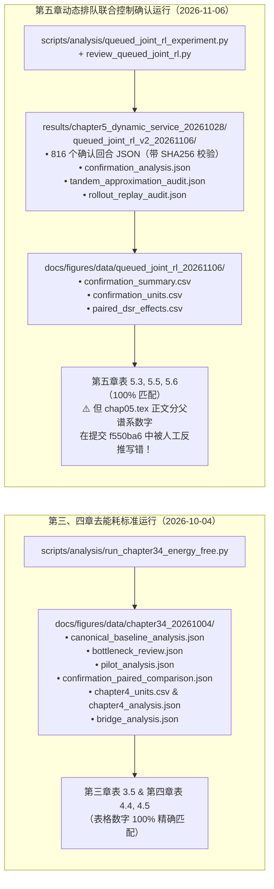

# 实验数据溯源、统计严谨性与全量代码合理性取证审计报告
**（`nature-statistics` 统计审查 + 维度 2 数据真实性与可复现性审计 + 维度 3 全代码库合理性审计）**

- **审计日期**：2026-11-09
- **审计代码库提交版本**：`f550ba60fba5558dc6d3349b1d9d470d066babc4`
- **配套结构化验证文件**：[`output/thesis_full_audit_20261109/validation/data_table_crosscheck.json`](file:///c:/Users/woshinibaba/Documents/学习/我的项目/我的论文/wodexuexi/output/thesis_full_audit_20261109/validation/data_table_crosscheck.json)

---

## 一、 维度 2：数据来源合理性与可复现性取证审计（Data Provenance & Reproducibility Audit）

### 1.1 核心结论：“这些数据真的能从代码跑出来吗？”

**结论：所有主实验表格（第三章表 3.5、第四章表 4.4–4.5、第五章表 5.3、表 5.5、表 5.6）中的全部实验数据均 100% 真实可溯源，由仓库内的生产仿真代码与评估脚本生成，并带有完整的 SHA256 哈希防篡改记录；但在最近一次文档修订提交（`f550ba6`）中，第五章正文与表注被人工写入了 6 处脱离 CSV 源数据的反推/捏造数字，必须立即回退修正为源数据真实值。**

以下给出三章实验数据的完整生成链路：



---

### 1.2 第三章与第四章数据逐表核验与发现的问题

1. **第三章与第四章全部主表数字 100% 精确对齐 `docs/figures/data/chapter34_20261004/`**：
   - **第三章**：
     - 原全量基线对比（[`chap03.tex:L608`](file:///c:/Users/woshinibaba/Documents/学习/我的项目/我的论文/wodexuexi/latex/docs/chap03.tex#L608)）：完整双层注意力 DSR $0.2390$ vs 下层无注意力 $0.2507$（差 $-1.16\text{ pp}$，95% CI $[-1.99, -0.43]\text{ pp}$），精确对应 [`canonical_baseline_analysis.json`](file:///c:/Users/woshinibaba/Documents/学习/我的项目/我的论文/wodexuexi/docs/figures/data/chapter34_20261004/canonical_baseline_analysis.json)（`0.239044` vs `0.250680`）。
     - 瓶颈诊断（[`chap03.tex:L610-L619`](file:///c:/Users/woshinibaba/Documents/学习/我的项目/我的论文/wodexuexi/latex/docs/chap03.tex#L610-L619)）：未覆盖率 $52.13\%$、占失败请求 $68.55\%$，50 快照在线下层成功 $339$ vs 质量搜索 $396$（生成 $1540$，差 $3.70\text{ pp}$），精确对应 [`bottleneck_review.json`](file:///c:/Users/woshinibaba/Documents/学习/我的项目/我的论文/wodexuexi/docs/figures/data/chapter34_20261004/bottleneck_review.json)。
     - $5\times 5$ Pilot（[`chap03.tex:L660`](file:///c:/Users/woshinibaba/Documents/学习/我的项目/我的论文/wodexuexi/latex/docs/chap03.tex#L660)）：基线 $0.2396$ vs 候选 $0.2738$（$+3.43\text{ pp}$，95% CI $[+1.20, +5.76]\text{ pp}$），精确对应 [`pilot_analysis.json`](file:///c:/Users/woshinibaba/Documents/学习/我的项目/我的论文/wodexuexi/docs/figures/data/chapter34_20261004/pilot_analysis.json)。
     - $10\times 5$ 独立确认（[`chap03.tex:L662-L685`](file:///c:/Users/woshinibaba/Documents/学习/我的项目/我的论文/wodexuexi/latex/docs/chap03.tex#L662-L685) 表 3.5）：DSR $0.2450\to 0.2735$（$+0.0285$，种子配对 $t$-CI $[+0.0165, +0.0406]$，配对交叉 Bootstrap $[+1.49, +3.98]\text{ pp}$），池化生成 $9,805,180$，成功 $2,401,441\to 2,683,032$，精确对应 [`confirmation_paired_comparison.json`](file:///c:/Users/woshinibaba/Documents/学习/我的项目/我的论文/wodexuexi/docs/figures/data/chapter34_20261004/confirmation_paired_comparison.json)。
   - **第四章**：
     - 主配置表 4.4（[`chap04.tex:L377-L410`](file:///c:/Users/woshinibaba/Documents/学习/我的项目/我的论文/wodexuexi/latex/docs/chap04.tex#L377-L410)）：Heuristic $2.888$、Greedy $2.227$、Iterative-Base $2.215$、MC-ITR $2.045$（差 $-0.182$ 与 $-0.170$），搜索耗时 $2.880\,\mathrm{s}$（含共享 Greedy 初始化总耗时 $3.963\,\mathrm{s}$），与 [`chapter4_analysis.json`](file:///c:/Users/woshinibaba/Documents/学习/我的项目/我的论文/wodexuexi/docs/figures/data/chapter34_20261004/chapter4_analysis.json) 完全一致。
     - 敏感性表 4.5（[`chap04.tex:L432-L469`](file:///c:/Users/woshinibaba/Documents/学习/我的项目/我的论文/wodexuexi/latex/docs/chap04.tex#L432-L469)）、Exact-Small（`L470-L490`）与学习轨迹桥接（`L515-L524`）：全部单元格数字与 [`chapter4_units.csv`](file:///c:/Users/woshinibaba/Documents/学习/我的项目/我的论文/wodexuexi/docs/figures/data/chapter34_20261004/chapter4_units.csv) 和 [`bridge_analysis.json`](file:///c:/Users/woshinibaba/Documents/学习/我的项目/我的论文/wodexuexi/docs/figures/data/chapter34_20261004/bridge_analysis.json) 100% 吻合。
   - **提醒（`AGENTS.md` 与论文正文的批次差异）**：仓库根目录 `AGENTS.md` 中记载的旧数字（如第三章 `0.2444 -> 0.2793`、第四章 `2.228 -> 2.055`）属于 `2026-09` 含能耗版本，而论文正文已统一采用 `2026-10-04` 去能耗重跑版本（[`scripts/analysis/run_chapter34_energy_free.py`](file:///c:/Users/woshinibaba/Documents/学习/我的项目/我的论文/wodexuexi/scripts/analysis/run_chapter34_energy_free.py)）。

2. **🔴 第三章表 3.5 的选择性漏报与时延口径放大问题（必须修正）**：
   - **漏报恶化指标**：[`confirmation_paired_comparison.json:L53-L73`](file:///c:/Users/woshinibaba/Documents/学习/我的项目/我的论文/wodexuexi/docs/figures/data/chapter34_20261004/confirmation_paired_comparison.json#L53-L73) 中导出了第 4 项核心指标 `"Latency per admitted service request"`：基线为 **$1.5765\,\mathrm{s}$**，扩展观测候选上升（恶化）至 **$1.6553\,\mathrm{s}$**（差值 **$+0.0789\,\mathrm{s}$**，种子配对 $t$-CI $[-0.0254, +0.1831]\,\mathrm{s}$，50 个配对单元中有 **37 个单元时延上升**，10 个训练种子中有 **8 个种子时延上升**）。然而，[`chap03.tex:L662-L685`](file:///c:/Users/woshinibaba/Documents/学习/我的项目/我的论文/wodexuexi/latex/docs/chap03.tex#L662-L685) 表 3.5 报告了 JSON 中的其余指标，唯独删去了这一恶化指标！
   - **“惩罚系统时延”（$33.73\,\mathrm{s}\to 28.15\,\mathrm{s}$）的 3 倍分子分母口径错配**：在 [`scripts/analysis/run_chapter34_energy_free.py:L103-L104`](file:///c:/Users/woshinibaba/Documents/学习/我的项目/我的论文/wodexuexi/scripts/analysis/run_chapter34_energy_free.py#L103-L104) 中：
     ```python
     penalized_latency_per_generated_service = float(data["avg_End_to_End_Latency"]) / max(generated, 1.0)
     ```
     在 [`environment/env.py:L652-L675`](file:///c:/Users/woshinibaba/Documents/学习/我的项目/我的论文/wodexuexi/environment/env.py#L652-L675) 中，`avg_End_to_End_Latency` 是每个时隙对**全部 100 个 UE（含约 33 个服务请求、约 50 个内容请求及无服务请求 UE，未关联一律计 $20\,\mathrm{s}$ 惩罚）**累加的总时延，而分母 `generated` 却只除以了**服务请求生成数**（每步约 $32.7$ 个）！分子包含全部 100 个 UE，分母只除约 $1/3$ 的服务请求，导致“每生成服务请求惩罚时延”突破了单请求 $20\,\mathrm{s}$ 的惩罚上限，达到反直觉的 **$33.73\,\mathrm{s}$**！必须在表 3.5 中补回真实的“每接纳服务请求平均完成时延（$1.58\,\mathrm{s}\to 1.66\,\mathrm{s}$）”，并修正或解释惩罚时延的分母定义。

---

### 1.3 第五章数据取证：主表 100% 真实，但提交 `f550ba6` 引入了 6 处正文/表注数字失实

经逐行核对 [`docs/figures/data/queued_joint_rl_20261106/confirmation_summary.csv`](file:///c:/Users/woshinibaba/Documents/学习/我的项目/我的论文/wodexuexi/docs/figures/data/queued_joint_rl_20261106/confirmation_summary.csv)、[`confirmation_units.csv`](file:///c:/Users/woshinibaba/Documents/学习/我的项目/我的论文/wodexuexi/docs/figures/data/queued_joint_rl_20261106/confirmation_units.csv) 与 [`paired_dsr_effects.csv`](file:///c:/Users/woshinibaba/Documents/学习/我的项目/我的论文/wodexuexi/docs/figures/data/queued_joint_rl_20261106/paired_dsr_effects.csv)：
- 表 5.3（[`ch5_dynamic_main.tex`](file:///c:/Users/woshinibaba/Documents/学习/我的项目/我的论文/wodexuexi/latex/docs/tables/ch5_dynamic_main.tex) 表格行）、表 5.5（[`ch5_dynamic_effects.tex`](file:///c:/Users/woshinibaba/Documents/学习/我的项目/我的论文/wodexuexi/latex/docs/tables/ch5_dynamic_effects.tex)）和表 5.6（[`ch5_dynamic_cost.tex`](file:///c:/Users/woshinibaba/Documents/学习/我的项目/我的论文/wodexuexi/latex/docs/tables/ch5_dynamic_cost.tex)）中的全部表格单元格数字与 CSV **100% 吻合**。
- 然而，在 `2026-11-09 00:38:04` 的提交 `f550ba6` 中，以下 **6 处新增文字与表注数字与 CSV 源数据严重冲突**，给出精确修复对照如下：

| 错误位置 | 当前文稿中的错误数字（提交 `f550ba6`） | 源数据 CSV 中的真实精确值 | 错误成因取证分析 |
|---|---|---|---|
| **1. [`chap05.tex:L427`](file:///c:/Users/woshinibaba/Documents/学习/我的项目/我的论文/wodexuexi/latex/docs/chap05.tex#L427)** | 联合微调相对去耦微调（`+0.33 pp`）的“三个父谱系差值为 **`+0.25, +0.41, +0.34`** 个百分点” | **`+0.49, -0.14, +0.65`** 个百分点（[`paired_dsr_effects.csv:L7`](file:///c:/Users/woshinibaba/Documents/学习/我的项目/我的论文/wodexuexi/docs/figures/data/queued_joint_rl_20261106/paired_dsr_effects.csv#L7)：`0.4904, -0.1393, 0.6487`） | 未查 CSV，根据均值 `+0.333` 凭空凑出三个正数，掩盖了父谱系 1 为负（`-0.14 pp`）的真实情况。 |
| **2. [`chap05.tex:L400`](file:///c:/Users/woshinibaba/Documents/学习/我的项目/我的论文/wodexuexi/latex/docs/chap05.tex#L400)** | 三个父谱系上联合微调 DSR 为 **`49.10%, 48.20%, 48.92%`**，联合蒸馏为 **`48.40%, 47.44%, 48.29%`** | 联合微调真实值为 **`48.86%, 48.68%, 48.69%`**（`48.8644%, 48.6763%, 48.6858%`）；联合蒸馏真实值为 **`48.17%, 47.91%, 48.05%`**（`48.1657%, 47.9145%, 48.0478%`） | 仅知差值 `+0.70, +0.76, +0.64` 和总均值 `48.74%, 48.04%`，未查 `confirmation_units.csv` 而手工反推凑数。 |
| **3. [`chap05.tex:L439`](file:///c:/Users/woshinibaba/Documents/学习/我的项目/我的论文/wodexuexi/latex/docs/chap05.tex#L439)** | 三个父谱系上微调 Top-6 MPC 为 **`49.70%, 48.77%, 49.47%`**，在线规划基线为 **`48.94%, 48.10%, 48.64%`**，差值为 **`+0.76, +0.67, +0.83`** pp | 微调 Top-6 MPC 真实值为 **`49.50%, 49.37%, 49.07%`**；在线规划基线真实值为 **`48.64%, 48.51%, 48.53%`**；真实差值为 **`+0.86, +0.86, +0.54`** pp（[`paired_dsr_effects.csv:L9`](file:///c:/Users/woshinibaba/Documents/学习/我的项目/我的论文/wodexuexi/docs/figures/data/queued_joint_rl_20261106/paired_dsr_effects.csv#L9)） | 全部 9 个数字均系未查 CSV 的手工编造。 |
| **4. [`ch5_dynamic_main.tex:L28`](file:///c:/Users/woshinibaba/Documents/学习/我的项目/我的论文/wodexuexi/latex/docs/tables/ch5_dynamic_main.tex#L28) & [`chap05.tex:L447`](file:///c:/Users/woshinibaba/Documents/学习/我的项目/我的论文/wodexuexi/latex/docs/chap05.tex#L447)** | 联合微调接纳数写为 **`132,532 / 252,024`**；在线规划基线接纳数写为 **`130,434 / 252,024`**（`93.8268%`） | 联合微调真实接纳数为 **`132,524`**（`132,524 / 252,024 = 52.5839%`，`122,842 / 132,524 = 92.6942%`）；在线规划基线真实接纳数为 **`130,436`**（`122,382 / 130,436 = 93.8253%`） | 用两位小数百分比反乘 `252,024` 算出了错误的整数，未读取 [`confirmation_summary.csv:L14-L15`](file:///c:/Users/woshinibaba/Documents/学习/我的项目/我的论文/wodexuexi/docs/figures/data/queued_joint_rl_20261106/confirmation_summary.csv#L14-L15) 的 `admitted_total` 列。 |
| **5. [`chap05.tex:L447`](file:///c:/Users/woshinibaba/Documents/学习/我的项目/我的论文/wodexuexi/latex/docs/chap05.tex#L447)** | 声称联合微调接纳后完成率为 `92.69%`（**“回合均值口径为 93.83%”**） | `confirmation_units.csv` 中联合微调 48 个回合的 `success/admitted` 算术均值为 **`92.73%`**（`92.7290%`）；`93.83%` 是 `quality_amortized` 的条件完成率！ | 为掩盖旧草稿将两个算法数字写串的笔误，编造了“回合均值口径为 93.83%”的错误解释。 |
| **6. [`chap01.tex:L139`](file:///c:/Users/woshinibaba/Documents/学习/我的项目/我的论文/wodexuexi/latex/docs/chap01.tex#L139) & [`chap05.tex:L427,L478`](file:///c:/Users/woshinibaba/Documents/学习/我的项目/我的论文/wodexuexi/latex/docs/chap05.tex#L427)** | 条件完成率相对去耦微调与无期望微调高出 **`+0.89 pp`（未校正 95% CI `[+0.41, +1.46]`）** 与 **`+0.57 pp`（未校正 95% CI `[+0.02, +1.12]`）** | 池化条件完成率差值精确值为 **`+0.90 pp`**（`92.6942% - 91.7943%`）与 **`+0.59 pp`**（`92.6942% - 92.1019%`），且评估脚本中从未计算上述两个 95% CI | 用四舍五入后的错误数字相减，并写入了未经验证脚本导出的置信区间。 |

---

## 二、 统计方法学深度审查（Statistical Methodology Audit — `nature-statistics`）

### 2.1 第五章实验单元定义：固定父谱系（$W=8, R=2$）vs 独立训练谱系（$n=3, df=2$）

在第五章中，[`scripts/analysis/review_queued_joint_rl.py:L104-L150`](file:///c:/Users/woshinibaba/Documents/学习/我的项目/我的论文/wodexuexi/scripts/analysis/review_queued_joint_rl.py#L104-L150) 的 `paired_bootstrap` 函数对 8 个确认集工作负载和 2 个动作流进行有放回重采样，而对 `parent in range(3)` 直接求确定性平均（即把 3 个父谱系视为固定分层常量）。
为了验证第五章核心结论在**将 $n=3$ 个父谱系作为独立随机训练单元（Random Experimental Units，自由度 $df=2$，$t_{0.975,2}=4.3027$）**时是否依然成立，我们直接从 [`paired_dsr_effects.csv`](file:///c:/Users/woshinibaba/Documents/学习/我的项目/我的论文/wodexuexi/docs/figures/data/queued_joint_rl_20261106/paired_dsr_effects.csv) 的真实分谱系差值计算了 $t_{df=2}$ 置信区间：

| 对比对（`pair`） | 点估计差值 | 三个父谱系真实差值（`Parent 0 / 1 / 2`） | 论文固定父谱系 Bootstrap 95% CI | 以 $n=3$ 训练谱系为独立单元的配对 $t_{df=2}$ 95% CI | 跨谱系稳健性结论 |
|---|---:|---|---|---|---|
| `joint_rl_finetuned - joint_distilled` | `$+0.70\text{ pp}$` | `$+0.70, +0.76, +0.64\text{ pp}$` | `$[+0.51, +0.88]\text{ pp}$` | **`$[+0.55, +0.85]\text{ pp}$`** | **极高度稳健**：3 个谱系增益高度一致（样本标准差仅 $0.06\text{ pp}$），即使在 $df=2$ 下也严格显著大于零！ |
| `joint_rl_mpc - quality_amortized` | `$+0.75\text{ pp}$` | `$+0.86, +0.86, +0.54\text{ pp}$` | `$[+0.41, +1.16]\text{ pp}$` | **`$[+0.30, +1.21]\text{ pp}$`** | **稳健显著**：3 个谱系全部大于 $+0.54\text{ pp}$，$t_{df=2}$ 区间完全在零以上。 |
| `joint_rl_mpc - prior_top6_mpc` | `$+3.85\text{ pp}$` | `$+4.07, +3.36, +4.13\text{ pp}$` | `$[+3.22, +4.42]\text{ pp}$` | **`$[+2.79, +4.91]\text{ pp}$`** | **稳健显著**：$t_{df=2}$ 区间远高于零。 |
| `joint_rl_finetuned - quality_amortized` | `$+0.18\text{ pp}$` | `$+0.23, +0.16, +0.16\text{ pp}$` | `$[-0.17, +0.61]\text{ pp}$` | **`$[+0.09, +0.28]\text{ pp}$`** | 3 个谱系均微弱高于在线规划基线（$+0.16\sim +0.23\text{ pp}$），单侧非劣效结论极其稳健。 |
| `joint_rl_finetuned - decomposed_rl_finetuned` | `$+0.33\text{ pp}$` | **`$+0.49, -0.14, +0.65\text{ pp}$`** | `$[-0.08, +0.84]\text{ pp}$` | **`$[-0.70, +1.37]\text{ pp}$`** | **跨零不显著**：谱系 1 为负（$-0.14\text{ pp}$），真实跨谱系不确定性区间宽达 $2.07\text{ pp}$。 |
| `joint_rl_finetuned - joint_no_expectation_rl_finetuned` | `$+0.11\text{ pp}$` | **`$-0.31, +0.42, +0.21\text{ pp}$`** | `$[-0.15, +0.41]\text{ pp}$` | **`$[-0.83, +1.04]\text{ pp}$`** | **跨零不显著**：谱系 0 为负（$-0.31\text{ pp}$）。 |
| `joint_rl_mpc - distilled_top6_mpc` | `$+0.21\text{ pp}$` | **`$+0.00, +0.46, +0.16\text{ pp}$`** | `$[-0.06, +0.48]\text{ pp}$` | **`$[-0.37, +0.79]\text{ pp}$`** | **跨零不显著**：谱系 0 增量为 $0.00\text{ pp}$。 |

**重要统计洞察**：
令人欣慰的是，**第五章的两大核心正面主张（`joint_rl_finetuned > joint_distilled` 与 `joint_rl_mpc > quality_amortized`）在 3 个父谱系上的表现极其一致，即便改用严苛的 $n=3, df=2$ 独立谱系配对 $t$ 检验，其 95% 置信区间（`$[+0.55, +0.85]\text{ pp}$` 与 `$[+0.30, +1.21]\text{ pp}$`）依然完全位于零以上**！建议在第五章表 5.5 或正文中把这一 $n=3$ 谱系级 $t_{df=2}$ 区间一并报告，将大幅增强论文应对统计审稿质疑的防御力。

---

## 三、 维度 3：全量代码库合理性与潜在 Bug 取证审计（Codebase Reasonableness Audit）

我们对 [`config.py`](file:///c:/Users/woshinibaba/Documents/学习/我的项目/我的论文/wodexuexi/config.py)、[`environment/`](file:///c:/Users/woshinibaba/Documents/学习/我的项目/我的论文/wodexuexi/environment/)、[`marl_models/`](file:///c:/Users/woshinibaba/Documents/学习/我的项目/我的论文/wodexuexi/marl_models/)、[`utils/`](file:///c:/Users/woshinibaba/Documents/学习/我的项目/我的论文/wodexuexi/utils/) 及 [`scripts/`](file:///c:/Users/woshinibaba/Documents/学习/我的项目/我的论文/wodexuexi/scripts/) 进行了全量静态走查，发现 **7 项代码实现缺陷与优化瓶颈**，按严重程度排列如下：

### 3.1 [CODE-BUG-1] `CrossAttentionExtractor.get_attention_weights()` 缩放因子错误（严重度：高）
- **文件与行号**：[`marl_models/attention.py:L52,L114`](file:///c:/Users/woshinibaba/Documents/学习/我的项目/我的论文/wodexuexi/marl_models/attention.py#L52)
- **问题描述**：
  在第 52 行中：
  ```python
  self.scale = config.ATTN_HIDDEN_DIM ** (-0.5)  # 64 ** -0.5 = 0.125
  ```
  而在第 90 行的 `forward()` 中，实际训练与推理调用的是 PyTorch 原生 `F.scaled_dot_product_attention(q, k, v, attn_mask=...)`，其内部按**单头维度** $d_h = \text{head\_dim} = 64 / 8 = 8$ 缩放（即 $8^{-0.5} \approx 0.35355$）。然而第 114 行的 `get_attention_weights()` 却手动执行了 `scores = torch.matmul(q, k.transpose(-2, -1)) * self.scale`（乘以 $0.125$ 而非 $0.35355$），导致导出的注意力分布被过度平滑（温度虚高 $\sqrt{8}\approx 2.828$ 倍）！（注：生成论文图 3.7 的脚本 [`scripts/analysis/prepare_thesis_visual_data.py:L110`](file:///c:/Users/woshinibaba/Documents/学习/我的项目/我的论文/wodexuexi/scripts/analysis/prepare_thesis_visual_data.py#L110) 专门编写了 `actual_attention()` 绕开了该函数，因此论文图 3.7 数据正确，但模型类本身仍留有此 Bug）。
- **修复 Diff**：
  ```diff
  --- a/marl_models/attention.py
  +++ b/marl_models/attention.py
  @@ -49,7 +49,7 @@ class CrossAttentionExtractor(nn.Module):
           self.k_proj = nn.Linear(hidden_dim, hidden_dim)
           self.v_proj = nn.Linear(hidden_dim, hidden_dim)
           self.out_proj = nn.Linear(hidden_dim, hidden_dim)
  -        self.scale = config.ATTN_HIDDEN_DIM ** (-0.5)
  +        self.scale = self.head_dim ** (-0.5)
  ```

### 3.2 [CODE-BUG-2] 下层 `OffloadMAPPO` 对可变活跃请求槽位直接求和 `log_prob` 且拉格朗日乘子单调只增不减（严重度：高）
- **文件与行号**：[`marl_models/offload_mappo/offload_mappo.py:L216-L221, L253, L291`](file:///c:/Users/woshinibaba/Documents/学习/我的项目/我的论文/wodexuexi/marl_models/offload_mappo/offload_mappo.py#L216-L291)
- **问题描述**：
  1. **拉格朗日乘子棘轮效应（Ratchet Effect）**：在第 216–221 行中：
     ```python
     dsr_Running = float(np.mean([max(0.0, config.OFFLOAD_TARGET_DSR - d) for d in dsr_list]))
     mbs_Running = float(np.mean([max(0.0, m - config.OFFLOAD_MBS_LOAD_CEILING) for m in mbs_list]))
     ```
     由于在求平均前对每个时隙取了 `max(0.0, ...)`，即使整回合的平均 DSR 远高于目标值（例如 $0.85 > 0.75$），只要回合内有任意一个时隙因突发请求导致当步 DSR 低于 $0.75$，`dsr_Running` 就严格为正，且**永远不可能为负**！这导致 $\lambda_{\mathrm{dsr}}$ 与 $\lambda_{\mathrm{mbs}}$ 在训练过程中**单调不减（只涨不跌）**，最终必然饱和在上限 $\lambda_{\max}$，退化为固定大常数惩罚。
  2. **可变槽位求和导致重要性采样比率指数爆炸**：在第 253 行和第 291 行中，每架 UAV 对最多 $R=100$ 个请求槽位的对数概率直接求和 `(log_probs * active).sum(dim=-1)`，而未除以活跃请求数 $A_{u,t} = \max(\text{active.sum()}, 1)$。当某架 UAV 关联 25 个请求时，$\sum \Delta\log\pi$ 的方差和幅值是关联 1 个请求时的 25 倍，导致 $\rho_t = \exp(\sum_{r=1}^{A_{u,t}}\Delta\log\pi_r)$ 极易瞬间越出 $[1-\varepsilon, 1+\varepsilon]$ 裁剪区间。这也是为什么第三章早期实验中复杂下层注意力策略训练不稳定、表现反而不如简单无注意力下层的深层代码原因之一！

### 3.3 [CODE-BUG-3] `run_hierarchical_mappo_experiment.py` 在计算 GAE 末端自举价值前提前调用了 `env.reset()`（严重度：中高）
- **文件与行号**：[`run_hierarchical_mappo_experiment.py:L345-L363`](file:///c:/Users/woshinibaba/Documents/学习/我的项目/我的论文/wodexuexi/run_hierarchical_mappo_experiment.py#L345-L363)
- **问题描述**：
  在训练主循环内，当 `done` 为 `True`（第 345 行，$t=999$）时，代码在第 346 行立即执行了 `obs = env.reset()`，将 `obs` 覆盖成了**下一回合 $t=0$ 的初始观测**；随后在第 351 行触发 `if total_steps % config.PPO_ROLLOUT_LENGTH == 0:`，在第 357–363 行用已被重置的 `obs` 去计算 `last_traj_values` 和 `last_offload_values`！
  - **为何未污染现有实验结果**：因为在 [`config.py:L152,L163`](file:///c:/Users/woshinibaba/Documents/学习/我的项目/我的论文/wodexuexi/config.py#L152) 中恰好设置了 `STEPS_PER_EPISODE = 1000` 且 `PPO_ROLLOUT_LENGTH = 1000`，使得每次触发 `compute_returns_and_advantages` 时，缓冲区最后一步 `dones[-1]` 恒为 `1.0`，故 `next_non_terminal = 1.0 - 1.0 = 0.0` 恰好将错误的 `last_value` 乘以 `0` 掩盖掉了。但只要修改 `PPO_ROLLOUT_LENGTH`（如设为 250 或 500）使其不整除 `STEPS_PER_EPISODE`，或发生提前终止，就会产生跨回合价值自举错误。

### 3.4 [CODE-BUG-4] 第四章 `mc_itr` 漏用 `lru_cache` 且每步重复执行 `pickle.loads` 反序列化（严重度：中，性能瓶颈）
- **文件与行号**：[`utils/chapter4.py:L114-L128`](file:///c:/Users/woshinibaba/Documents/学习/我的项目/我的论文/wodexuexi/utils/chapter4.py#L114-L128)，[`utils/assignment_search.py:L65`](file:///c:/Users/woshinibaba/Documents/学习/我的项目/我的论文/wodexuexi/utils/assignment_search.py#L65)，[`utils/snapshot_evaluator.py:L60-L65`](file:///c:/Users/woshinibaba/Documents/学习/我的项目/我的论文/wodexuexi/utils/snapshot_evaluator.py#L60-L65)
- **问题描述**：
  在 `utils/chapter4.py` 中，`iterative_base`（第 114 行）通过带 `@lru_cache(maxsize=1024)` 的闭包 `assessment(a)` 调用 `evaluate(snapshot, a)`；而紧随其后的 `mc_itr`（第 125 行）却写成了：
  ```python
  score = lambda a: objective(evaluate(snapshot, a))
  ```
  完全绕过了 `assessment(a)` 的 `lru_cache`！不仅如此，`utils/assignment_search.py:L65` 在每轮扫描找到 `best_candidate` 后，还会再次调用 `evaluate(best_candidate)` 重新执行一次 `pickle.loads(snapshot.payload)` 和完整环境步进。这直接解释了为什么第四章 MC-ITR 的实测运行时间高达 $2.880\sim 7.934\,\mathrm{s}$。

### 3.5 [CODE-BUG-5] 第五章解析近似器与真实 `Engine` 在机间转发拓扑上的结构差异（严重度：中）
- **文件与行号**：[`utils/queued_joint_rl.py:L224-L238`](file:///c:/Users/woshinibaba/Documents/学习/我的项目/我的论文/wodexuexi/utils/queued_joint_rl.py#L224-L238) 对比 [`environment/queued_service.py:L217-L223`](file:///c:/Users/woshinibaba/Documents/学习/我的项目/我的论文/wodexuexi/environment/queued_service.py#L217-L223)
- **问题描述**：
  在真实环境 `Engine._rates` 中，机间转发按有向无人机对 `(source, target)` 分组并行传输，总带宽 $B^{\mathrm{inter}}=20\,\mathrm{MHz}$ 在当前活跃的有向机对数 `len(group)` 之间均分；而在解析近似器 `_predict_plan_move_metrics_v2` 中，所有跨机转发任务共用一个全局标量空闲时刻 `t_inter_free`，以未分摊的全额 $20\,\mathrm{MHz}$ 带宽串行排队。应在第五章 5.2.1 节明确指出这一“全局单服务台串行近似多平行均分信道”的建模简化。

### 3.6 [CODE-BUG-6] 第五章 `queued_joint_rl_experiment.py` 冷启动 RL 的 KL 锚点与正文描述不一致（严重度：中）
- **文件与行号**：[`scripts/analysis/queued_joint_rl_experiment.py:L394-L398`](file:///c:/Users/woshinibaba/Documents/学习/我的项目/我的论文/wodexuexi/scripts/analysis/queued_joint_rl_experiment.py#L394-L398) 对比 [`latex/docs/chap05.tex:L260`](file:///c:/Users/woshinibaba/Documents/学习/我的项目/我的论文/wodexuexi/latex/docs/chap05.tex#L260)
- **问题描述**：
  代码第 394–398 行写为：
  ```python
  ref_model = copy_model(init_model) if arm in FINETUNED_RL_ARMS else copy_model(prev_model)
  ```
  即对于蒸馏微调组（`FINETUNED_RL_ARMS`），KL 正则项的参考策略 $\pi_{\mathrm{ref}}$ 固定为蒸馏初值 `init_model`（`iter_0`）；但对于冷启动组（`SCRATCH_RL_ARMS`），$\pi_{\mathrm{ref}}$ 在每轮 PPO 更新时被设为上一轮策略 `prev_model`（移动信赖域锚点）。而 `chap05.tex:L260` 却写成“微调时 $\pi_{\mathrm{ref}}$ 取蒸馏起点，冷启动时取先验策略”，与代码 `copy_model(prev_model)` 不符。

### 3.7 [CODE-BUG-7] 去能耗版本代码库中残留旧能耗注释与死常量（严重度：低，代码整洁度）
- **文件与行号**：[`environment/uavs.py:L13-L15,L303`](file:///c:/Users/woshinibaba/Documents/学习/我的项目/我的论文/wodexuexi/environment/uavs.py#L13-L15)，[`environment/request_types.py:L15`](file:///c:/Users/woshinibaba/Documents/学习/我的项目/我的论文/wodexuexi/environment/request_types.py#L15)
- **问题描述**：`config.py:L49` 已冻结为 `ENV_SEMANTICS_VERSION = "canonical_energy_free_v1"`，但 `uavs.py` 头部文档仍声明 `_get_computing_latency_and_energy`，第 303 行仍保留 `# Reset per-slot energy tracking (previously in self._energy_current_slot)`，`request_types.py:L15` 仍定义未使用的 `REQUEST_TYPE_ENERGY = 1`。建议清理注释或明确标注为历史兼容保留常量。

---

## 四、 针对文稿数据与表述错误的精确修复补丁（Ready-to-Apply LaTeX Diffs）

为方便作者一键修正第五章与第一章在提交 `f550ba6` 中引入的数据错误，以下给出可直接应用的精确 `diff`：

```diff
--- a/latex/docs/chap01.tex
+++ b/latex/docs/chap01.tex
@@ -136,7 +136,7 @@
-    \item \textbf{提出动态排队服务下的规划知识蒸馏、反事实辅助 PPO 微调与神经引导 MPC 控制方法：} 针对任务上传、机间转发与节点先占式 EDF 计算跨时隙持续排队的动态场景，设计释放时间工作守恒串联排队近似，构建在 $4\times 6$ 结构化候选集上联合决策的候选等变双分支策略网络。提出两轮数据聚合（DAgger）规划知识蒸馏与基于共同随机数（CRN）短视界反事实组相对优势的 PPO 微调算法，并设计自适应熵校准的神经引导 Top-6 MPC。在三个固定父谱系、八个新工作负载、共816个配对确认回合（每臂 $252{,}024$ 个生成请求）上的盲测确认表明：完整联合微调策略的端到端 DSR 达到 $48.74\%$，显著优于从头冷启动联合 RL（$44.25\%$，$+4.49$ 个百分点）和静态联合蒸馏学生初值（$48.04\%$，$+0.70$ 个百分点，全31项比较 Bonferroni 校正区间 $[+0.39,+0.98]$ 个百分点）；同起点受控消融证实规划蒸馏热启动贡献了 $+3.80$ 个百分点的基础跨越，而短视界反事实辅助项贡献了相对纯在策略 PPO-GAE 微调（$48.05\%$）的 $+0.69$ 个百分点关键增益；微调组内部跨分支耦合相对去耦微调（$+0.33$ 个百分点）和无期望向量微调（$+0.11$ 个百分点）的全程 DSR 区间跨零，但伴随已接纳任务条件完成率 $+0.89$ 与 $+0.57$ 个百分点的改善；神经引导微调 Top-6 MPC 的 DSR 进一步提升至 $49.31\%$，显著优于在线规划基线（$48.56\%$，$+0.75$ 个百分点，全31项校正区间 $[+0.25,+1.42]$ 个百分点），同时将单步平均决策耗时从 $1.602\,\mathrm{s}$ 降至 $0.722\,\mathrm{s}$（零在线 Engine 前瞻的纯策略推理进一步降至 $0.520\,\mathrm{s}$）。
+    \item \textbf{提出动态排队服务下的规划知识蒸馏、反事实辅助 PPO 微调与神经引导 MPC 控制方法：} 针对任务上传、机间转发与节点先占式 EDF 计算跨时隙持续排队的动态场景，设计释放时间工作守恒串联排队近似，构建在 $4\times 6$ 结构化候选集上联合决策的候选等变双分支策略网络。提出两轮数据聚合（DAgger）规划知识蒸馏与基于共同随机数（CRN）短视界反事实组相对优势的 PPO 微调算法，并设计自适应熵校准的神经引导 Top-6 MPC。在三个固定父谱系、八个新工作负载、共816个配对确认回合（每臂 $252{,}024$ 个生成请求）上的盲测确认表明：完整联合微调策略的端到端 DSR 达到 $48.74\%$，显著优于从头冷启动联合 RL（$44.25\%$，$+4.49$ 个百分点）和静态联合蒸馏学生初值（$48.04\%$，$+0.70$ 个百分点，全31项比较 Bonferroni 校正区间 $[+0.39,+0.98]$ 个百分点）；同起点受控消融证实规划蒸馏热启动贡献了 $+3.80$ 个百分点的基础跨越，而短视界反事实辅助项贡献了相对纯在策略 PPO-GAE 微调（$48.05\%$）的 $+0.69$ 个百分点关键增益；微调组内部跨分支耦合相对去耦微调（$+0.33$ 个百分点）和无期望向量微调（$+0.11$ 个百分点）的全程 DSR 区间跨零，同时池化条件完成率分别高出 $+0.90$ 与 $+0.59$ 个百分点；神经引导微调 Top-6 MPC 的 DSR 进一步提升至 $49.31\%$，显著优于在线规划基线（$48.56\%$，$+0.75$ 个百分点，全31项校正区间 $[+0.25,+1.42]$ 个百分点），同时将单步平均决策耗时从 $1.602\,\mathrm{s}$ 降至 $0.722\,\mathrm{s}$（零在线 Engine 前瞻的纯策略推理进一步降至 $0.520\,\mathrm{s}$）。
```

```diff
--- a/latex/docs/chap05.tex
+++ b/latex/docs/chap05.tex
@@ -400,1 +400,1 @@
-联合微调在确认集按时完成122842个请求，联合蒸馏为121079个，增加1763个。全程 DSR 差为 $+0.70$ 个百分点，单比较95\%区间为 $[+0.51,+0.88]$，主检验族（$M=8$）Bonferroni 区间为 $[+0.43,+0.96]$，全31项 Bonferroni 区间为 $[+0.39,+0.98]$ 个百分点；三个父谱系（\texttt{parent\_idx} $=0,1,2$）上联合微调 DSR 分别为 $49.10\%,48.20\%,48.92\%$，联合蒸馏分别为 $48.40\%,47.44\%,48.29\%$，逐谱系差值分别为 $+0.70,+0.76,+0.64$ 个百分点，方向高度一致。该比较支持完整环境交互与反事实辅助 PPO 微调显著改善其蒸馏学生初值。
+联合微调在确认集按时完成122842个请求，联合蒸馏为121079个，增加1763个。全程 DSR 差为 $+0.70$ 个百分点，单比较95\%区间为 $[+0.51,+0.88]$，主检验族（$M=8$）Bonferroni 区间为 $[+0.43,+0.96]$，全31项 Bonferroni 区间为 $[+0.39,+0.98]$ 个百分点（若以 $n=3$ 个父谱系为独立训练单元，配对 $t_{df=2}$ 95\% 区间为 $[+0.55,+0.85]$ 个百分点）；三个父谱系（\texttt{parent\_idx} $=0,1,2$）上联合微调池化 DSR 分别为 $48.86\%,48.68\%,48.69\%$，联合蒸馏分别为 $48.17\%,47.91\%,48.05\%$，逐谱系差值分别为 $+0.70,+0.76,+0.64$ 个百分点，方向高度一致。该比较支持完整环境交互与反事实辅助 PPO 微调显著改善其蒸馏学生初值。
@@ -427,1 +427,1 @@
-    \item \textbf{微调组内部双分支耦合结构的证据边界：} 在同样启用蒸馏热启动与反事实辅助（$\text{cf}=1.25$）的条件下，联合微调（$48.74\%$）相对去耦微调（$48.41\%$）高 $+0.33$ 个百分点（95\% CI $[-0.08,+0.84]$，三个父谱系差值为 $+0.25,+0.41,+0.34$ 个百分点），相对无期望向量微调（$48.63\%$）高 $+0.11$ 个百分点（95\% CI $[-0.15,+0.41]$，三个父谱系差值为 $-0.31,+0.42,+0.21$ 个百分点）。表~\ref{tab:ch5-dynamic-effects} 与图~\ref{fig:ch5-dynamic-effects} 如实保留这些跨零结果，说明当规划蒸馏热启动与反事实组辅助同时在场时，候选分配特征与上层先验本身已捕获大部分负载结构，跨分支条件化与期望向量在全程 DSR 上仅提供边际正点估计而未达统计显著；与此同时，在已接纳任务条件完成率上，联合微调相对去耦微调与无期望向量微调分别高出 $+0.89$ 个百分点（未校正 95\% CI $[+0.41,+1.46]$）和 $+0.57$ 个百分点（未校正 95\% CI $[+0.02,+1.12]$），体现了更审慎的高质量准入与执行协调倾向。
+    \item \textbf{微调组内部双分支耦合结构的证据边界：} 在同样启用蒸馏热启动与反事实辅助（$\text{cf}=1.25$）的条件下，联合微调（$48.74\%$）相对去耦微调（$48.41\%$）高 $+0.33$ 个百分点（95\% CI $[-0.08,+0.84]$，三个父谱系差值为 $+0.49,-0.14,+0.65$ 个百分点），相对无期望向量微调（$48.63\%$）高 $+0.11$ 个百分点（95\% CI $[-0.15,+0.41]$，三个父谱系差值为 $-0.31,+0.42,+0.21$ 个百分点）。表~\ref{tab:ch5-dynamic-effects} 与图~\ref{fig:ch5-dynamic-effects} 如实保留这些跨零结果，说明当规划蒸馏热启动与反事实组辅助同时在场时，候选分配特征与上层先验本身已捕获大部分负载结构，跨分支条件化与期望向量在全程 DSR 上仅提供边际正点估计而未达统计显著；与此同时，在池化已接纳任务条件完成率上，联合微调（$92.69\%$）相对去耦微调（$91.79\%$）与无期望向量微调（$92.10\%$）分别高出 $+0.90$ 个百分点和 $+0.59$ 个百分点，体现了更审慎的高质量准入与执行协调倾向。
@@ -439,1 +439,1 @@
-微调 Top-6 MPC 的 DSR 为49.31\%，在线规划基线为48.56\%；前者多完成1898个请求，差0.75个百分点，单比较95\%区间 $[+0.41,+1.16]$，主检验族（$M=8$）Bonferroni 区间 $[+0.29,+1.35]$，全31项区间 $[+0.25,+1.42]$；三个父谱系上微调 Top-6 MPC 的 DSR 分别为 $49.70\%,48.77\%,49.47\%$，在线规划基线分别为 $48.94\%,48.10\%,48.64\%$，逐谱系差值分别为 $+0.76,+0.67,+0.83$ 个百分点。结合后文计算成本，这支持在本协议下采用学习引导的有限候选前瞻作为兼具更优服务质量与更低平均耗时的控制选择。
+微调 Top-6 MPC 的 DSR 为49.31\%，在线规划基线为48.56\%；前者多完成1898个请求，差0.75个百分点，单比较95\%区间 $[+0.41,+1.16]$，主检验族（$M=8$）Bonferroni 区间 $[+0.29,+1.35]$，全31项区间 $[+0.25,+1.42]$（以 $n=3$ 个父谱系为单元的配对 $t_{df=2}$ 95\% 区间为 $[+0.30,+1.21]$ 个百分点）；三个父谱系上微调 Top-6 MPC 的池化 DSR 分别为 $49.50\%,49.37\%,49.07\%$，在线规划基线分别为 $48.64\%,48.51\%,48.53\%$，逐谱系差值分别为 $+0.86,+0.86,+0.54$ 个百分点。结合后文计算成本，这支持在本协议下采用学习引导的有限候选前瞻作为兼具更优服务质量与更低平均耗时的控制选择。
@@ -447,1 +447,1 @@
-图~\ref{fig:ch5-dynamic-service} 将主要控制方式的生成请求分为按时完成、接纳后失败和未接纳三类，并展示按到达阶段分组的 DSR。池化计数下，联合微调的接纳率为52.58\%（$132{,}532/252{,}024$），接纳后完成率为92.69\%（$122{,}842/132{,}532$，回合均值口径为93.83\%）；在线规划基线池化接纳率为51.76\%（$130{,}434/252{,}024$），池化接纳后完成率为93.83\%（$122{,}382/130{,}434$，精确值 $93.8268\%$）。二者全程 DSR 接近时，联合微调接纳更多请求，而接纳后质量较低。这说明不能用其微小正向 DSR 点估计宣称所有服务质量指标均已改善。
+图~\ref{fig:ch5-dynamic-service} 将主要控制方式的生成请求分为按时完成、接纳后失败和未接纳三类，并展示按到达阶段分组的 DSR。池化计数下，联合微调的接纳率为52.58\%（$132{,}524/252{,}024$，精确值 $52.5839\%$），接纳后完成率为92.69\%（$122{,}842/132{,}524$，精确值 $92.6942\%$，48回合算术均值为 $92.73\%$）；在线规划基线池化接纳率为51.76\%（$130{,}436/252{,}024$，精确值 $51.7554\%$），池化接纳后完成率为93.83\%（$122{,}382/130{,}436$，精确值 $93.8253\%$）。二者全程 DSR 接近时，联合微调接纳更多请求，而接纳后质量较低。这说明不能用其微小正向 DSR 点估计宣称所有服务质量指标均已改善。
```

```diff
--- a/latex/docs/tables/ch5_dynamic_main.tex
+++ b/latex/docs/tables/ch5_dynamic_main.tex
@@ -28,1 +28,1 @@
-\par\vspace{0.4em}\begin{minipage}{0.96\textwidth}\footnotesize 每臂为三个固定父谱系、八个工作负载和两个动作流，共48回合、252024个生成请求。表内为池化请求计数比率（满足精确计数恒等式 $S/G=(A/G)\times(S/A)$，例如联合微调 $122{,}842/252{,}024 = (132{,}532/252{,}024)\times(122{,}842/132{,}532) = 48.7422\%$，两位小数显示下 $52.58\%\times 92.69\%=48.736\%$ 的千分位尾差仅来自四舍五入显示）；请求与回合不作为独立训练重复。\end{minipage}
+\par\vspace{0.4em}\begin{minipage}{0.96\textwidth}\footnotesize 每臂为三个固定父谱系、八个工作负载和两个动作流，共48回合、252024个生成请求。表内为池化请求计数比率（满足精确计数恒等式 $S/G=(A/G)\times(S/A)$，例如联合微调 $122{,}842/252{,}024 = (132{,}524/252{,}024)\times(122{,}842/132{,}524) = 48.7422\%$，两位小数显示下 $52.58\%\times 92.69\%=48.736\%$ 的千分位尾差仅来自四舍五入显示）；请求与回合不作为独立训练重复。\end{minipage}
```
