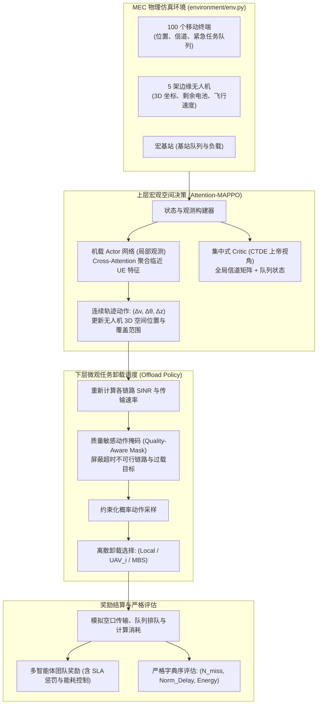

# wodexuexi 项目 AI 全景技术说明书

> **适用对象**：AI 编码助手、自主 Agent、强化学习与分布式边缘计算（MEC）研究员  
> **核心定位**：基于 Attention-MAPPO 的多无人机协同移动边缘计算（MEC）轨迹与任务卸载优化系统（中大硕士论文工程）。  
> **核心架构**：分层多智能体强化学习（Hierarchical MARL）+ 集中式训练分布式执行（CTDE）+ 自注意力变长状态聚合 + 严格字典序多目标优化。

---

## 1. 项目定位与系统边界（Project Overview & Mission Boundaries）

### 1.1 业务场景与端-边-云协同体系
在工业物联网、车联网以及应急救援等大规模端侧场景中，单一端侧设备（手机、车载传感器）的本地算力与电池容量存在物理墙；同时，地面宏基站（MBS）可能因灾毁坏或通信距离过远导致传输延迟超标。
系统构建了**端-边-云三级异构协同算力网络**：
- **端（UE）**：100 个地面移动终端，动态产生具有硬性截止时间（Deadline）的计算任务。
- **边（UAV-MEC）**：5 架部署边缘算力的旋翼无人机，执行 3D 轨迹机动与近端计算卸载。
- **云（MBS）**：1 个地面宏基站边缘数据中心，具备充沛计算资源但面临回传带宽与链路排队约束。

### 1.2 关键架构决策（Why）

#### 1. 为什么坚决不用传统的“加权和（Weighted Sum）”优化目标？
- 学术界传统做法采用标量加权化目标：
  $$J = \alpha \cdot \text{Delay} + \beta \cdot \text{Energy}$$
- **致命缺陷**：加权系数 $\alpha, \beta$ 缺乏物理可解释性，更关键的是会诱发模型产生“牺牲长尾偏远终端的任务超时（Deadline Miss），换取全网平均能耗显著降低”的病态策略。在安全与工业控制领域，**任务超时违约是不可接受的硬性 SLA 事故**！
- **解法**：采用**严格字典序多目标优化准则（Lexicographical Optimization）**：
  $$F(A) = \left( N_{\text{miss}}, \; \frac{1}{M}\sum_{m=1}^{M} \frac{T_m}{\text{deadline}_m}, \; \frac{E_{\text{comp}}}{25000\text{ J}} \right)$$
  决策评估时，第一优先级比较任务超时数 $N_{\text{miss}}$；完全相同时才比较相对时延；最后才比较能耗。在数学上杜绝牺牲 SLA 换取低能耗的妥协。

#### 2. 为什么使用自注意力（Attention）替代传统 MLP 处理终端状态？
- 100 个地面终端随着无人机移动动态进入/离开覆盖范围，状态维度动态变化；
- 普通 MLP 只能接受固定维度拼接向量，无法支持终端数量弹性变化，且丢失了几何空间排列不变性；
- **自注意力机制**将无人机状态作为 Query，所有终端状态作为 Key/Value，天然实现**排列不变性（Permutation Invariance）**，权重 $\alpha_i$ 物理自适应聚焦于最紧急、信道最好的终端。

---

## 2. 完整文件与目录树图谱（Comprehensive File & Directory Map）

```
wodexuexi/
├── README.md                          # 官方研究总览与分支演进指引
├── CANONICAL_SEMANTICS_SPEC.md        # 规范实验语义与度量契约规范文档
├── CHAPTER4_PROTOCOL.md               # 论文第四章仿真评估协议
├── config.py                          # 全局物理环境参数 (信道、无人机、终端动力学)
├── paths.py                           # 统一路径管理与数据导出定位器
├── environment/                       # MEC 仿真物理环境核心引擎
│   ├── env.py                         # 主环境类 (Step, Reset, 状态转换与奖励结算)
│   ├── comm_model.py                  # 空地 A2G 概率视距信道、香农传输容量计算
│   ├── uavs.py                        # 无人机 3D 动力学、推进能耗与防碰撞包线
│   ├── user_equipments.py             # 终端移动模型、高斯随机任务生成、电池衰减
│   └── request_types.py               # 任务数据结构 (计算量、数据量、Deadline)
├── marl_models/                       # 强化学习核心算法与网络架构
│   ├── attention.py                   # Multi-Head Attention 自注意力层实现
│   ├── attention_mappo.py             # Attention-MAPPO 上层轨迹策略网络
│   ├── offload_policy.py              # 下层约束化离散任务卸载决策网络
│   ├── buffer_and_helpers.py          # 经验回放缓冲区、GAE 计算与 Value Loss
│   ├── joint_mappo.py                 # 端到端联合优化基线算法
│   ├── vanilla_mappo.py               # 无注意力机制的标准 MAPPO 基线
│   ├── ippo_baseline.py               # 独立 PPO (IPPO) 对比基线
│   └── uncoordinated_greedy_model.py  # 无协调贪心启发式基线
├── tasks/                             # 任务调度与排队模型
├── utils/                             # 评测与统计工具集
│   ├── canonical_experiment.py        # 规范实验执行流水线
│   ├── baseline_metrics.py            # 字典序排序与多维指标统计
│   └── comparative_plots.py           # 论文标准图表绘制脚本
├── scripts/                           # 批量实验运行脚本
├── tests/                             # 单元测试与环境边界验证用例
└── latex/                             # 硕士论文 LaTeX 源码与配图资产
```

---

## 3. 架构与全链路数据流（Architecture & Execution Pipelines）



---

## 4. 底层核心算法与工程实现机理（Underlying Algorithms & Engineering）

### 4.1 空地（A2G）通信信道物理模型
无人机与地面终端之间的无线链路采用 3GPP 概率视距（Probabilistic LoS）模型：
$$P_{\text{LoS}} = \frac{1}{1 + a \exp\left( -b \left[ \frac{180}{\pi}\theta - a \right] \right)}$$
其中 $\theta = \arcsin\left(\frac{h}{d}\right)$ 为无人机对终端的仰角，$a, b$ 为环境传播参数（城市密集区/郊区）。
链路平均路损：
$$\text{PL}(d, \theta) = P_{\text{LoS}} \cdot \text{PL}_{\text{LoS}}(d) + (1 - P_{\text{LoS}}) \cdot \text{PL}_{\text{NLoS}}(d)$$
香农可达传输速率：
$$R_{i,j} = B_{i,j} \log_2\left( 1 + \frac{P_{\text{tx}} \cdot 10^{-\text{PL}/10}}{\sigma^2} \right)$$
无人机通过 3D 空间机动提升仰角 $\theta$，显著提高视距概率，突破边缘带宽瓶颈。

### 4.2 Multi-Head Attention 处理变长终端状态
设无人机自身的观测特征为 $h_{\text{uav}} \in \mathbb{R}^{d_{\text{uav}}}$，覆盖范围内的 $K$ 个终端特征为 $H_{\text{ue}} \in \mathbb{R}^{K \times d_{\text{ue}}}$：
1. 投影映射为 Query、Key、Value：
   $$Q = h_{\text{uav}} W_Q, \quad K = H_{\text{ue}} W_K, \quad V = H_{\text{ue}} W_V$$
2. 计算自注意力权重矩阵：
   $$\alpha_k = \frac{\exp\left( \frac{Q K_k^T}{\sqrt{d_k}} \right)}{\sum_{j=1}^{K} \exp\left( \frac{Q K_j^T}{\sqrt{d_k}} \right)}$$
3. 聚合上下文向量：
   $$\text{Context} = \sum_{k=1}^{K} \alpha_k V_k$$
网络参数不随终端数量 $K$ 改变，具备天然的伸缩性与排列不变性。

### 4.3 CTDE（集中式训练与分布式执行）
- **训练阶段**：集中式 Critic $V(S_{\text{global}})$ 接入全网 100 个终端真实队列积压、5 架无人机剩余电量与全球信道增益矩阵，精确评估基线优势 $A_t = R_t + \gamma V(S_{t+1}) - V(S_t)$。
- **执行阶段**：各无人机机载 Actor $\pi(a_i | o_i)$ 仅依赖机载 GPS、局部雷达与覆盖范围内接收到的信标消息，独立前向推理动作，完全不需要空中跨机通信（消除了协作通信带宽开销）。

---

## 5. 核心接口与数据结构规范（API Specification & Contracts）

### 5.1 MEC 主环境接口（`environment/env.py`）
```python
class MultiUAVMECEnv:
    def reset(self, seed: Optional[int] = None) -> Tuple[Dict[str, np.ndarray], Dict]:
        """重置物理环境，生成终端位置、移动轨迹及初始任务"""
        
    def step(self, actions: Dict[str, np.ndarray]) -> Tuple[
        Dict[str, np.ndarray], # next_obs: 各 UAV 局部观测 [batch, obs_dim]
        Dict[str, float],      # rewards: 各智能体奖励
        Dict[str, bool],       # dones: 仿真回合结束标志
        Dict[str, Any]         # info: 包含 N_miss, mean_delay, energy_comp 真实物理统计
    ]:
        """推进一个宏观时间步 (默认 1.0s)，联合执行轨迹与微观卸载"""
```

### 5.2 任务数据结构定义（`environment/request_types.py`）
```python
@dataclass
class OffloadRequest:
    request_id: str
    ue_id: int
    data_size_bits: float      # 输入数据量 (bits)
    cpu_cycles: float          # 所需计算周期数 (cycles)
    deadline_sec: float        # 硬性超时截断时间 (秒)
    generated_time_sec: float  # 生成绝对时间戳
    assigned_target: int       # 0: Local, 1~5: UAV_i, 6: MBS
```

---

## 6. 配置体系与实验复现指南（Configuration & Deployment Runbook）

### 6.1 运行依赖
- Python 3.9+ 或 3.10
- PyTorch 2.0+ (CUDA 11.8+ / CPU)
- 核心包：`numpy`, `scipy`, `pandas`, `matplotlib`, `pyyaml`

### 6.2 规范实验（Canonical Suite）运行
项目遵循**训练集与测试集严格场景隔离（5 种子 × 10 独立场景）**：
```bash
cd wodexuexi

# 1. 运行环境与算法单元测试
pytest tests/

# 2. 启动 Attention-MAPPO 规范训练
python run_canonical_experiment.py --algo attention_mappo --seeds 42 43 44 45 46

# 3. 运行全基线矩阵对比评测 (Attention-MAPPO vs Joint-MAPPO vs IPPO vs Greedy)
python run_baseline_matrix_v2.py --output-dir results/formal_suite

# 4. 生成论文标准统计表与对比曲线
python analyze_canonical_suite.py --result-dir results/formal_suite
```

---

## 7. 硬核边界条件与避坑排障（Corner Cases & Troubleshooting）

1. **空中物理碰撞硬约束（Airborne Collision Avoidance）**：
   - *问题*：强化学习早期探索时，无人机可能因距离过近发生空中相撞。
   - *防御*：环境内嵌基于人工势场法（APF）的安全护栏（Safety Filter）。当两架无人机水平距离 $< 20\text{ m}$ 且高度差 $< 5\text{ m}$ 时，强制施加排斥加速度矢量，覆写 RL 危险动作并给予严厉碰撞惩罚。
2. **基站算力排队爆炸与死锁（Buffer Bloat）**：
   - *问题*：若所有终端均将任务卸载至 MBS，宏基站计算队列无限累积，导致后续全部任务违约。
   - *防御*：质量感知掩码（`Quality-Aware Mask`）。调度器实时检测 MBS 队列深度；当排队估计时延超过任务自身剩余 Deadline 时，直接在动作空间中将 MBS 选项置为 $-\infty$ 屏蔽，迫使任务就近卸载或由本地计算。
3. **Sim-to-Real Gap（仿真向真实迁移鲁棒性）**：
   - *问题*：真实场景中无线信道存在快衰落与突发风阻。
   - *防御*：在环境训练中启用了**域随机化（Domain Randomization）**，每个 Episode 随机扰动信道大尺度衰落系数 $\pm 15\%$，风阻扰动加入均值为 0 的 Ornstein-Uhlenbeck 随机过程，确保策略在非理想信道下不崩溃。
